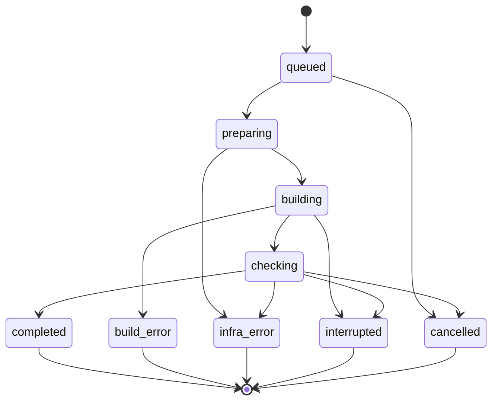

# 知因 CodeLab 四组关键契约 V1.0

日期：2026-09-27。文档版本 V1.0；目标数据和执行协议 `contractVersion: 2`。两种版本编号用途不同。

这是待实施的规范。现有 `packages/contracts/src/index.ts` 仍使用条目级协议；本文的接口、字段、状态和数据库约束尚未因文档创建而生效。

配套：[工程启动蓝图](../../output/知因CodeLab_工程启动蓝图_V1.0_2026-09-27.md)、[实施任务与验收](IMPLEMENTATION_PLAN_V1.md)。

## 0. 通用约定

- 持久记录使用服务端生成的 UUID；`criterionId/caseId/probeId` 是任务包内稳定业务编号，不能与数据库 UUID 混用。
- 时间使用 UTC 的 ISO 8601；耗时另记毫秒。工作区在中国不意味着执行浏览器可随宿主自动改变时区。
- 所有进入信任边界的数据使用严格 schema 校验，拒绝未知字段、重复业务编号、越界数量和非法引用。
- 哈希使用 SHA-256。结构清单使用固定规范化 JSON 算法：对象键排序，声明为集合的数组按稳定 ID 排序，步骤等有顺序语义的数组保留顺序，编码为 UTF-8；记录算法版本。
- `originalZipSha256` 是收到的 ZIP 原始字节哈希。`sourceManifestSha256` 是实际允许源码的清单哈希，清单含规范化相对路径、每个文件字节长度和内容哈希。文件内容不在无记录的情况下转换换行或编码。
- runner 只收到源码映射时，只能重算源码清单哈希；ZIP 哈希是关联信息，不能声称 runner 验证了原始 ZIP。
- `requestId` 是调用追踪编号；`idempotencyKey` 是同一业务请求的重放身份；`operationId` 是一次外部动作的持久身份；租约令牌仅用于执行所有权，不作为用户可见业务编号。
- 业务幂等键以“操作者＋动作类型＋目标范围＋键”确定作用域，并保存 requestHash。先鉴权再返回重放结果，不能通过猜中他人的键读取对象。
- 本文 `must/必须` 均指实现约束。验收完成后才在运行状态文档中标记通过。

## C1. 教学要求、验收包与检查案例

### C1.1 任务包与教师规则

任务包由开发者维护并验证；教师从已验证的包中确认要求和有界参数。自然语言备注不会自动变成可执行测试。

| 对象 | 必需字段 | 约束 |
| --- | --- | --- |
| TaskPackManifest | `contractVersion, packId, packVersion, contentHash, templateVersion, templateHash, dependencyLockHash, initializationVersion, aggregationVersion, criteria, cases, probes, parameterSchema` | 包发布后不可原地改写；逻辑、初始化、探查、参数语义变化均新建版本 |
| CriterionDefinition | `criterionId, displayCode, title, mode, expectedBehavior` | `mode=auto/manual`；同包内 ID 唯一；人工项不虚构自动案例 |
| CaseDefinition | `caseId, criterionId, setupPlanId, expected, plannedSteps, timeoutMs, implementationHash` | 前置、操作、断言均有定义；步骤 ID 稳定；实现来自可信测试包 |
| ProbeDefinition | `probeId, applicableCriterionIds, parameterSchema, setupPlanId, plannedPaths, maxDurationMs, implementationHash` | 只执行发布过的探查，不接收模型编排的动作 |
| RuleSnapshot | `ruleId, taskId, version, packManifest, packManifestHash, enabledCriterionIds, requiredCaseIds, parameterValues, parametersHash, confirmedBy, confirmedAt` | 发布时复制完整清单；历史规则不跟随包文件变化 |

自动条目至少启用一个必需案例；首版只允许任务包声明的完整案例组，开发切片使用单独开发包。教师不能关闭某个必需案例后仍声称满足完整课程条目。

同一教学任务切换规则生成新的 RuleSnapshot。学生提交记录原规则；默认 Run 使用该原规则。旧提交不会因教师修改当前规则而改变要求。

### C1.2 首版案例矩阵

| 内部条目 / 显示码 | 案例 | 准备与断言 | 独立性 |
| --- | --- | --- | --- |
| `create / CK-01` | `NEW-01` | 记录初始数量；唯一有效标题；新增后数量恰好加一且标题只对应一项 | 新浏览器上下文，不依赖其他案例 |
| `validation / CK-02` | `VALID-01` | 空字符串提交，数量不变；提示是否必需由规则定义 | 独立上下文 |
| `validation / CK-02` | `VALID-02` | 纯空格提交，数量不变；按规则观察提示 | 与 VALID-01 分开执行 |
| `toggle / CK-03` | `STATE-01` | 本案例创建并确认目标任务；未完成→完成→未完成，任务身份保持一致 | 同一案例内双向操作；失败后未执行步骤明确标识 |
| `filter / CK-04` | `FILTER-01` | 准备并确认混合状态；检查“全部”包含准确任务集合 | 独立准备 |
| `filter / CK-04` | `FILTER-02` | 同样准备；初始全部→未完成，只显示未完成集合 | 独立准备 |
| `filter / CK-04` | `FILTER-03` | 同样准备；初始全部→已完成，只显示完成集合 | 不含“先未完成再已完成”的路径 |
| `persistence / CK-05` | `SAVE-01` | 创建目标、改变状态并确认；在同一上下文刷新，标题、数量及状态保留 | 刷新保留本案例上下文，其他案例不共享 |

五项核心共八个初始自动案例。空结果、长度边界等额外案例只有写入教师确认的规则后才启用。现有编辑、删除如继续启用，也要声明各自案例和版本。

优先按角色、标签和公开的 testId 定位；任务包公开交互约定。初始化通过正常界面准备，或使用明确公开并版本化的初始化接口。不得读取参考答案的私有数组或存储键来准备状态。

### C1.3 原始案例结果

以下 TypeScript 是结构说明，需在实施时转成严格的 Zod schema 和类型；不是当前已导出的代码。

```ts
type Verdict = "passed" | "failed" | "manual" | "not_run";

type ExecutedStep = {
  stepId: string;
  phase: "setup" | "action" | "assert";
  startedAt: string;
  finishedAt?: string;
  state: "completed" | "failed" | "interrupted";
  observation: string;
  evidenceIds: string[];
};

type CaseResult = {
  criterionId: string;  // 例如 create
  caseId: string;       // 例如 NEW-01
  verdict: Verdict;
  preconditionStatus: "satisfied" | "blocked" | "uncertain";
  reasonCode: string;
  expected: string;
  observed: string;
  executedSteps: ExecutedStep[];
  unexecutedStepIds: string[];
  blockedBy: Array<{
    kind: "setup_step" | "execution_stage";
    id: string;
    reasonCode: string;
  }>;
  evidenceIds: string[];
};
```

`plannedSteps` 在任务包中；`executedSteps` 只能记录真正开始过的动作。未开始的动作列入 `unexecutedStepIds`，不能把全套计划复制成“实际复现步骤”。步骤只标记中断不代表动作完全没有外部效果。

`blockedBy` 引用本案例的准备步骤或执行阶段。例如筛选自己创建混合数据失败时引用 `setup:create-mixed-tasks`。即使另一案例 NEW-01 失败，也不能仅凭它推断本案例已尝试过准备。

### C1.4 分类与聚合

| 情形 | 案例结果 | 原因码示例 | 可以得出的结论 |
| --- | --- | --- | --- |
| 前置成立、观察满足公开要求 | `passed` | `ASSERTION_SATISFIED` | 本案例范围内满足 |
| 前置成立、可靠观察明确违反要求 | `failed` | `ASSERTION_MISMATCH` | 对应行为不满足 |
| 数据准备失败 | `not_run` | `SETUP_BLOCKED` | 尚未具备检查条件 |
| 构建失败 | `not_run` | `BUILD_ERROR` | 功能没有检查；Run 为 build_error |
| 可信页面服务、浏览器或执行器故障 | `not_run` | `INFRA_ERROR` | 无法归因于学生功能 |
| 资源上限、截止、取消或失联 | `not_run` | `RESOURCE_LIMIT/TIME_BUDGET/CANCELLED/INTERRUPTED` | 本次未完成；保留已经有效提交的部分 |
| 交互约定不兼容、证据歧义 | `manual` | `CONTRACT_AMBIGUOUS/OBSERVATION_AMBIGUOUS` | 需要教师判断 |

定位超时必须由可信检查逻辑分类：若已确认页面正常、约定入口可检查且要求的控件确实缺失，可以判明确失败；无法区分定位适配和功能问题时使用 `manual`。不能只按异常类名统一判失败。

自动条目聚合固定为 `aggregation-v1`：

1. 至少一个前置成立且有明确违规的必需案例失败 → `failed`。
2. 否则有必需案例 `not_run` → `not_run`。
3. 否则有必需案例 `manual` → `manual`。
4. 否则所有必需案例通过且集合非空 → `passed`。

聚合同时返回 `failedCaseIds/notRunCaseIds/manualCaseIds/passedCaseIds`。条目失败不能掩盖其他案例没执行。人工条目自动层结果始终为 `manual`，教师判断在 C3 中处理。

### C1.5 首个探查 FILTER_ORDER_CHECK

2026-09-29实现补充（保留以下原要求）：逐步取证输出最大10张PNG与1份JSON；probe交接总额11MiB、输出文件数11，导出遍历另计输入文件共12；PNG每份1MiB、JSON64KiB。下文quota-v3的probe 1MiB/4文件属于历史版本，已被本项替代，build/check限额不变。新增调查机会的记录格式及未知值处理见[评测协议v2](../../eval/protocol-v2.md)，不将机会等同实际分析收益。

- 只在规则启用该探查、筛选已有失败、准备可完成且路径 B 未被基础检查覆盖时计为有新增调查机会。
- 路径 A：初始全部→已完成；路径 B：初始全部→未完成→已完成。
- 两条路径分别创建独立上下文，采用相同混合状态准备；保存每步控件值、任务身份、可见集合和截图。
- 初始参数为空对象，严格拒绝其他字段。以后增加参数需发布新包，并给枚举或上下界。
- 结果分 `observed/blocked/inconclusive`，不产生新的基础 CaseResult，不改变原始判定。
- 两条路径不同只能支持“本次两条路径观察不同”；原因仍可能涉及偶发状态或准备差异。无新增事实也需记录，不能只保留成功展示的探查。

## C2. 执行身份、证据和模块接口

### C2.1 上下文绑定

每次执行请求绑定：`submissionId + originalZipSha256 + sourceManifestSha256 + runId + executionAttemptId + ruleId/ruleHash + packManifestHash + templateHash`。这些字段由可信业务端从持久记录生成。

runner 校验自己加载的模板与包哈希、重算实际源码清单，并解析实际执行镜像；worker 核对响应回显与发出的请求。只回显收到的字符串不能证明 runner 真正执行了对应内容。

自动测量指纹 `MeasurementFingerprint` 至少包含：

| 部分 | 内容 |
| --- | --- |
| 规则与实现 | 规则哈希、包哈希、模板哈希、依赖锁哈希、初始化版本、参数哈希、聚合版本 |
| 实际执行镜像 | 构建、静态服务、浏览器三个内容摘要或本地 image ID，并记录标识类型 |
| 浏览器条件 | Playwright 和实际 Chromium 版本、视口、locale、timezone |
| 其他行为条件 | 时钟策略、随机策略、页面服务策略、关键资源和超时配置版本 |

首版自动比较使用完整指纹严格相等，不推测版本号相近就兼容。指纹不包含会因每次提交自然不同的 runId、源码哈希和运行时间。记录真实时间或未控制随机数时要注明其限制，配置相同不等于所有运行无波动。

实际环境记录使用 `MeasuredEnvironment={completeness:complete|partial|unknown, values, missingFields}` 包裹指纹。正常测量和自动比较要求 complete；环境尚未启动就失败时，允许持久保存 partial/unknown 以解释故障，但不能把请求中的批准配置复制成已观察到的实际环境。observedSourceManifestSha256 未实际核验时同样为空并附原因。

模型供应商、模型版本、提示词、采样参数、工具协议、预算和输入清单另存为 `AnalysisConfiguration`，不进入基础检查兼容指纹。

### C2.2 证据与清单

| 字段 | 语义与约束 |
| --- | --- |
| `evidenceId, manifestId` | 唯一证据与所属清单；服务端验证唯一性，不以标题作 ID |
| `runId, submissionId, originalZipSha256, sourceManifestSha256` | 绑定提交与实际源码 |
| `executionAttemptId` | 基础证据来源；补充证据另记录其来源执行关系 |
| `analysisAttemptId, operationId` | 补充探查或按需源码片段必填；基础证据为空 |
| `scope` | `run` 或 `case`；运行级构建日志不伪造案例编号 |
| `criterionId, caseId` | 案例证据必填，必须在当前规则内；运行级可以为空 |
| `phase` | `build/base/probe/source_excerpt/diagnostic` |
| `collector` | 可信 runner 或受控业务提取器 |
| `contentOrigin` | `checker_observation/student_console/student_source/rendered_page/platform_diagnostic` |
| `ruleHash, packManifestHash` | 证据采集语境；重建探查另有实际指纹 |
| `sha256, byteSize, mediaType, storageKey` | 持久文件身份；存储键由服务端生成，不信任提交路径 |
| `capturedAt` | 实际采集时间；与数据库写入时间分开 |

可信采集器产生的日志仍可能包含学生输出。模型必须把日志、源码、页面文字和注释视为材料，不能将其中的命令当作工具权限或发布指令。

受控源码提取可生成 run 级 `source_excerpt`：来源须为 `business_extractor/student_source`，绑定实际提交清单、文件哈希与实际行范围；不得虚构 case 归属。该材料仅可支持可能原因，不能作为功能观察或教师判定功能通过的执行证据。单次最多 100 行，源码片段 JSON 不超过 8,000 bytes，工具完整返回不超过 12 KiB，截断必须显式标注。当前文本模型只收到截图索引，不得声称读取了截图像素。

清单 `ArtifactManifest` 包含版本、上下文、内容哈希、证据列表和 `completeness=complete/partial`。基础清单属于 ExecutionAttempt；补充清单属于 AnalysisOperation。清单一经提交不可追加覆盖；API 可以组合读取多个清单。

持久化顺序：

1. 写入当前 owner 专属暂存目录，逐个验证路径、类型、大小、哈希和归属。
2. 原子移动到受控持久位置，核实文件可读取；数据库引用不指向暂存文件。
3. 在数据库事务中检查有效租约、阶段、未封存状态与预期版本，提交清单和结果，再推进状态。
4. 中途失败留下的孤立文件进入受控回收；未提交文件不能供草稿引用。已经提交但后来存储损坏的内容标记不可用，不能静默替换原文件。

文件系统与数据库不是一个跨系统事务，因此要用“先持久文件、后原子索引、孤立文件回收”保证可解释性。回收前查询数据库引用；已发布证据不得作为临时文件清理。

首版协议上限建议：ZIP 压缩 10 MiB、实际解压 50 MiB、2,000 文件；单张 PNG 1 MiB；单个文本证据 UTF-8 64 KiB；单清单最多 200 个证据；单次 runner JSON 响应总字节 16 MiB。base64 膨胀计入响应总量，不能只统计解码后大小。所有阈值放入同一 `limits-v1` 配置并实测，不作为当前已实施配置。缺少必需证据时标记不完整，不能裁掉必需事实后仍声明完整报告。

源码传输固定为 `files: Record<规范化相对路径, base64原始字节>`；单文件解码后≤2 MiB，路径 UTF-8≤240 字节，总解码源码≤50 MiB，文件数≤2,000。`runnerRequestMaxBytes=75 MiB`，非文件业务元数据≤1 MiB；50 MiB 的 base64 约占 66.7 MiB，加路径及元数据仍须以最终 JSON 的实际 UTF-8 字节数核验。发送方同时检查解码与编码大小，接收方按流计数；不接受嵌入命令、绝对路径、穿越、路径冲突或链接。

### C2.3 worker 与 runner 协议

保留受限 `/execute`、`/probe`、`/cleanup` 动作并加入 `protocolVersion:2`，新增独立心跳与只读动作查询。runner v2 HTTP 路由统一使用 `/v2` 前缀；下表省略该前缀。它们只向可信后台进程开放，不暴露给浏览器用户或模型。

| 接口 | 关键输入 | 关键输出 |
| --- | --- | --- |
| `GET /capabilities` | 受控服务身份 | 协议、模板/包、实际镜像、浏览器、就绪/忙碌、活动 owner、残留与门槛记录版本 |
| `POST /execute` | 绑定上下文、ownerToken、operationId/requestHash、HTTP 追踪 requestId、白名单源码、规则快照、批准指纹、startedAt/leaseUntil/workDeadlineAt/hardDeadlineAt/remainingWorkMs | 原上下文、实际源码哈希、实际指纹、案例结果、证据清单及有界产物、阶段计时、资源状态 |
| `POST /probe` | 服务端绑定 `runId/analysisAttemptId/operationId/ownerKind/ownerId/ownerToken`，加 `probeId/parameters`、包哈希、workDeadlineAt/hardDeadlineAt/remainingWorkMs | 新补充清单、实际探查环境指纹、路径观察、是否新增信息及阻塞原因 |
| `POST /prepare-probe` | 仅显式重分析需要：不可变源码、批准模板/包、owner、operationId/requestHash、workDeadlineAt/hardDeadlineAt/remainingWorkMs | 只准备探查环境，不产生或覆盖基础结果；返回环境身份和实际指纹 |
| `POST /heartbeat` | 严格 `{protocolVersion:2,owner:{runId,ownerKind,ownerId,ownerToken},leaseUntil}` | 严格 `{protocolVersion:2,leaseUntil}`；仅返回已接受租约，不传内部 owner 元数据 |
| `POST /cleanup` | `protocolVersion:2`、run 与 owner 全部身份/令牌、operationId/requestHash/requestId | 幂等回收结果、残留清单、`clean/cleanup_pending` |
| `POST /operations/query` | 严格 `{protocolVersion:2,owner,operationId,requestHash?}`；身份和令牌放受信请求体 | 严格 `{record,response}`，无结果时 response 明确为 null；只读取持久状态，不触发重跑或续租 |

`prepare-probe` 复用可信构建准备函数，不开放命令、目录或通用操作参数。首条 NEW-01 不需要这个接口，实施到显式重新分析探查时才添加。

构建、浏览器动作与探查只能使用 workDeadlineAt 内的时间，hardDeadlineAt 留给最终回收；各阶段还取本阶段更短的截止。业务端绑定预算配置版本，runner 拒绝大于允许上限的期限。首次分析工具的工作截止还受 initialAnalysisDeadlineAt 约束，不能使用整个首次流水线剩余时间扩大分析额度。

首次执行必须传 `startedAt` 和 `leaseUntil`。共享 schema 静态要求 `startedAt < workDeadlineAt`、`hardDeadlineAt - startedAt <= 300000`、至少 30000 毫秒回收余量、`remainingWorkMs <= workDeadlineAt - startedAt`，并要求 `startedAt < leaseUntil <= hardDeadlineAt`。`startedAt`、工作/硬期限及动作内容绑定原始请求哈希；首次 owner 固定为上下文的 `{runId,ownerKind:'execution',ownerId:executionAttemptId}`。新 owner 接收时还需由 durable store 核验可信时钟、未来起始偏差至多 5 秒、初始租约尚未到期且至多接收时刻后 30 秒，并按绝对截止和接收的剩余毫秒数取更早期限。共享 schema 不直接读取当前时间，以便解析历史请求和动作记录；解析成功不等于获得新执行资格。

`hashExecuteRequest` 排除 `requestHash` 自身、HTTP `requestId`、`ownerToken` 和可变 `leaseUntil`，仍绑定上下文中的原始 run/execution owner 身份、`startedAt`、工作/硬期限、初始剩余预算及动作内容。排除令牌不代表允许替换令牌获得权限：每次调用仍先验证完整 owner 身份和令牌。同一个 owner 再次登记时不得更新旧租约、有效工作期限或起始时间；不同固定时间上下文必须拒绝。动作重放携带较晚的 `leaseUntil` 也不续租。

心跳独立于 execute HTTP 等待运行：worker 先在业务数据库成功提交 heartbeat，再把数据库确认的 leaseUntil 发给 runner；数据库失败立即停止 runner 续租。runner 的 store 原子核验 owner/token、owner 仍有效、旧租约尚未到期、新租约不倒退且不超过接收时刻后 30 秒和原 hardDeadlineAt。心跳 schema 不接收 startedAt、工作/硬期限或 operationId，不能借续租改预算。只有此接口能够续租；清理、重放和查询都不能。部署时仍需实测双方时钟偏差，不能用请求携带的时间替代接收端时钟。

`hashCleanupRequest` 统一计算 `sha256(canonicalJson({protocolVersion,owner:{runId,ownerKind,ownerId},operationId}))`；排除 requestHash、requestId 和 ownerToken，防止双方各自实现不同幂等身份。清理仍独立验证令牌和目标 owner，并校验请求哈希。动作查询的 requestHash 在传输 schema 中可选，worker 必须发送已登记值并核对返回 record 的 run、owner、operationId、kind 与 requestHash；有原响应时还需核对 `responseHash = sha256(canonicalJson(response))` 及对应动作的响应契约。query 返回原始持久响应，不泄露完整 store 快照或内部 tokenHash。

若 cleanup 先于迟到的 execute 到达，可信入口先通过 `registerCleanupOwner(owner)` 登记只允许清理的持久墓碑，再登记 cleanup 动作并交给 reaper 核验实际资源。未知 owner 直接进入 cleanup_pending，不伪造有效执行租约；内部时间占位不赋予工作资格。此记录可以和另一个活动 owner 并存，但只检查自己的精确归属，不能清理其他 owner 的资源。已有 owner 必须验证原 token/run 身份，登记函数不改变其租约或阶段；实际 cleanup 动作负责撤销工作资格。墓碑完成回收并变成 clean 后仍保留身份，迟到的 execute 不能重新登记并复活它。仅有标签但没有对应持久资源意图的 Docker 资源保持 ownership 残留，不因墓碑出现而获得删除授权。

一个基础响应的最小语义形状：

```text
protocolVersion: 2
context: { runId, executionAttemptId, submissionId, operationId, requestHash,
           originalZipSha256, observedSourceManifestSha256,
           ruleHash, packManifestHash, templateHash }
actualFingerprint: MeasuredEnvironment
outcome: complete | build_error | infra_error | interrupted | cancelled
caseResults: CaseResult[]
baseManifest: ArtifactManifest
artifacts: 有界文本和 PNG 字节
timings: 各阶段真实开始、结束与耗时
resourceState: retained_for_initial_analysis | cleaning | clean | cleanup_pending
```

对每个启用自动案例必须恰有一条结果；没执行的也明确返回原因。人工条目不要求 runner 虚构一条自动结果。响应字段缺失、重复案例、哈希不符、引用越界均视为协议或环境问题，不写成学生功能失败。未知指纹允许形成带明确原因的故障记录，但不能当作正常测量已验证或用于自动比较。

同一个 operationId、同一 requestHash：进行中返回明确状态，完成且保留结果则返回同一结果；同 operationId 不同载荷返回 409。requestId 只追踪本次 HTTP 请求，改变它不产生新动作。其他任务占用返回 `RUNNER_BUSY`。响应丢失后只能按 operationId 查询，无法确认时记 `unknown`，不自动换 ID 重发。

请求和响应都需边读边限量；`response.text()` 全部读入后才检查长度不满足流量上限约束。runner 对实际模板和镜像校验失败时拒绝执行。

### C2.4 面向工作台的接口契约

新业务协议使用 `/api/v2`，避免静默改变旧 `/api/v1` 的结果含义。登录、会话和不变的账号接口继续复用既有 `/api/v1`。新前端请求显式选择业务版本；旧报告走只读适配器，旧业务写接口切换时返回 `CLIENT_UPGRADE_REQUIRED`，不能把新数据序列化成旧结构。

| 方法与相对路径 | 请求要点 | 返回与授权 |
| --- | --- | --- |
| `POST /tasks` | `{classId,title,description}`、幂等键 | 所属教师新建任务；返回任务标识与元数据，规则另行发布 |
| `GET /tasks/:id` | 任务 ID | 当前规则、实际启用范围、模板；班级内可见 |
| `POST /tasks/:id/rules` | pack 版本、允许参数、确认及幂等键 | 新不可变 RuleSnapshot；教师 |
| `POST /tasks/:id/submissions` | ZIP、ruleId、幂等键 | `submissionId, accepted, enqueueState`；学生本人 |
| `POST /submissions/:id/runs` | 幂等键，可选 retryOfRunId | 新 Run 或已有请求结果；本人/所属教师 |
| `GET /runs/:id` | runId | 基础状态、分析摘要、报告可见状态；学生响应不包含草稿 |
| `POST /runs/:id/cancel` | 幂等键 | 基础运行仍活动才可取消；基础已封存则提示使用分析取消 |
| `POST /runs/:id/analyses` | 幂等键、expectedBaseManifestId | 新显式分析；教师；同运行无 queued/running 分析时可排队，领取时再检查资源 |
| `POST /analyses/:id/cancel` | 幂等键 | 终止本次分析、保留基础结果，进入回收 |
| `GET /runs/:id/review` | runId | 当前修订、候选与证据清单；仅所属教师 |
| `PUT /runs/:id/review` | expectedRevisionId、条目变更、教师判断、幂等键 | 追加修订；不直接覆盖旧快照 |
| `POST /runs/:id/review/confirm` | expectedRevisionId、条目 ID 与内容哈希、幂等键 | 追加带确认的修订 |
| `POST /runs/:id/review/adopt` | candidateId、expectedRevisionId、选定条目、幂等键 | 采纳候选形成新修订，不暗中覆盖教师判断 |
| `POST /runs/:id/publications` | expectedRevisionId、用途 latest/historical_correction、publicEvidenceIds、expectedLatestPublicationId 与 correctionReason（更正必填）、幂等键 | 不可变 Publication；教师；更正来源由服务端核验 |
| `POST /publications/:id/corrections` | expectedLatestPublicationId、expectedRevisionId、更正原因、幂等键 | 基于该历史发布创建新修订；教师；不覆盖较新草稿 |
| `GET /publications/:id` | publicationId | 教师或该学生可读的精确发布快照 |
| `GET /publications/:id/evidence/:evidenceId` | 两个 ID | 必须在该发布的公开证据白名单内 |
| `GET /runs/:id/evidence/:evidenceId` | 两个 ID | 教师读取该运行明确允许的基础/补充证据；不作为学生入口 |
| `GET /compare?before=...&after=...` | 两个 runId | 兼容性、原因码、案例差异；学生还要求两端有本人发布快照 |

任务列表、提交历史、模板下载与事件流沿用现有能力并适配 v2，返回契约版本。上述为必须改变语义的接口清单，不要求为了版本号重写不相关鉴权逻辑。

新建任务与发布规则是两个独立操作。`POST /tasks` 严格接收 `classId/title/description`：classId 为 UUID；去除首尾空白后 title 为 1—160 字符，description 为 0—5,000 字符。成功响应为 `{contractVersion:2,taskId,classId,title,description,createdAt}`。新任务尚无 v2 规则时，详情返回 `currentRule:null`、`rules:[]`；教师再选择服务端登记的包并调用规则发布接口。创建事务锁定所属班级，校验教师权限与幂等身份；同一身份但请求内容不同返回 409 `IDEMPOTENCY_CONFLICT`，不创建第二个任务。

HTTP 传输约定：所有新幂等写接口使用 `Idempotency-Key` 请求头（8—100 位字母、数字、下划线或连字符），与会话 Cookie、`X-CSRF-Token` 和同源检查共同使用。上传采用 multipart 单一 `file` 部件、`X-Rule-Id` 请求头，不另收表单字段；成功响应包含 `contractVersion:2, submissionId, ruleId, accepted:true, enqueueState:'not_requested', originalZipSha256, sourceManifestSha256`。规则发布请求为 `{packId,packVersion,packManifestHash,enabledCriterionIds,parameterValues,confirmed:true}`。包必须由服务端显式注入可信目录；未登记可执行包时返回空目录，不把夹具包注册为真实包。`BUSINESS_API_VERSION=1` 保持迁移期间的旧业务写路径，显式切到 `2` 后拒绝旧业务写入；两个版本的读取各自只序列化对应协议数据。

新增幂等资源写入返回 201，相同请求的幂等重放返回 200 并保留原资源身份与内容；新建排队运行返回 202，重放返回 200。队列满不删除已经接收的提交；创建运行返回 429 `QUEUE_FULL` 并带可重试说明。执行关闭返回 `EXECUTION_DISABLED`，与上传是否保存分别表达。单独调用上传接口不会保证已经排队。

报告写响应另带 `replayed` 布尔值：`PUT /runs/:id/review`、`POST /runs/:id/review/confirm`、`POST /runs/:id/review/adopt` 和 `POST /publications/:id/corrections` 新增修订时返回 201、`replayed:false`，幂等重放返回 200、`replayed:true`，并返回原修订的 `revisionId` 与内容；其余复核目录和最新发布摘要按读取时的状态返回。发布接口返回 `{contractVersion:2,publication,replayed}`，新增发布与重放同样使用 201/200。GET 复核不创建基础修订，也不返回 `replayed`；基础修订由受信 worker 在基础结果封存后显式建立。修订 CAS 冲突仍返回 409 `REVISION_CONFLICT`，不能将冲突当作成功重放。

统一错误结构：`{ error: { code, message, requestId, details? } }`。关键错误码包括 `REVISION_CONFLICT/EVIDENCE_SCOPE_MISMATCH/STALE_SUBMISSION/STALE_RUN/INCOMPATIBLE_MEASUREMENT/RUNNER_BUSY/BUDGET_EXHAUSTED/CLIENT_UPGRADE_REQUIRED`。未知或无权访问的个人对象采用一致的 404，避免泄露其存在。

### C2.5 比较规则

2026-09-29 显式比较落地：`GET /api/v2/compare?before=<runId>&after=<runId>` 严格只接收两个UUID查询字段，并要求不同运行、同一学生和任务。教师响应 `source:'sealed_results'`，`automatic` 来自封存结果与实际指纹，`teacherJudgments` 单独比较当前修订并返回两端修订ID；修订尚未建立时该项为null。学生响应 `source:'publications'`：同一查询选取两端当前最新发布ID，再读取这些精确不可变快照，返回发布身份、自动差异及已发布的教师判断/反馈；任一端未发布均404，不读取当前草稿作为替代。后续更正发布会影响再次请求时选中的最新发布，原publicationId链接保持可读。已有上一提交比较和精确publicationId比较入口继续保留。

比较先验证权限、同一学生和任务，再验证原始规则、包、模板、参数及实际指纹。首版采用严格相等；缺任一关键字段返回 `MEASUREMENT_UNKNOWN`，变化返回具体差异清单，`items=[]`，可并排阅读。

可比时逐案例映射：`failed→passed` 为本次已通过；`passed→failed` 为回归；`failed→failed` 为仍未满足；`passed→passed` 为仍通过；任一端 `manual/not_run` 为未知，不推断修复。教师判断变化单独显示，不混入原始自动结果对比。

条件改变时，需要重新取得同一条件下的两次运行才可判断。相同原规则但环境改变，可以对两份提交显式新建 Run。跨规则重绑定旧提交的专用操作不列入首个框架切片；在团队实验中可将两份原源码登记为新规则下的成对样本并重新执行，保留原提交来源。不得悄悄修改旧提交的 ruleId。

旧条目级记录只做历史阅读。新旧协议、案例集合或未知指纹之间不输出“修复/回归”的自动结论。

## C3. 原始结果、Agent 草稿、教师判断与发布

### C3.1 写权限矩阵

| 数据 | 允许写入者 | 封存与修改方式 |
| --- | --- | --- |
| RuleSnapshot、Submission | 教师发布服务、提交服务 | 新建后不可改内容 |
| 原始 CaseResult、基础清单与实际指纹 | 当前执行 owner 经 worker 校验提交；故障终结采用 C4.5 的受限恢复权限 | `baseSealedAt` 后不可改，即使原租约仍有效 |
| 补充证据清单 | 当前 AnalysisOperation 的受限工具网关 | 追加新清单；不得并回基础数组 |
| 模型候选草稿 | 校验后的分析服务 | 归属由服务端绑定；候选不可直接发布 |
| TeacherJudgment | 所属教师明确操作，经业务服务写入 | 新报告修订保存判断；不改原始结果 |
| ReportRevision | 报告服务 | 每次操作追加不可变修订 |
| Publication | 教师触发的发布服务 | 追加不可变快照；任何更正生成新版本 |

Student（学生）只能提交自己的源码、创建或取消有权操作的检查，并读取本人已发布报告。Agent 不拥有任务管理、任意数据库、用户身份、发布、删除、任意 HTTP 或 shell 工具。

### C3.2 模型草稿结构与引用

模型返回结构采用严格字段白名单，不包含 `verdict/runId/ownerToken/published` 等写权限字段。服务端在通过校验后补充来源。

```text
FeedbackItem:
  criterionId
  caseIds[]
  observation
  reproductionSteps[]
  observationEvidenceRefs[]
  possibleCause
  causeSupport: direct | limited | insufficient
  causeEvidenceRefs[]
  nextStep
  needsTeacherReview

EvidenceRef:
  scope: current | comparison_before | comparison_after
  manifestId
  evidenceId
```

`reproductionSteps` 的每项为 `{caseId,stepId,description}`，必须对应所引用案例的真实 `executedSteps`，不能把尚未执行的计划写成已完成复现。每份修订恰好为各启用条目保存一项反馈；自动条目的 `caseIds` 包含该条目的全部必需案例，人工条目为空。证据文件键采用 `runs/<runId>/<manifestId>/<evidenceId>.<png|txt|json>`，由服务端按身份验证；持久对象只追加、重读核对字节数与 SHA-256，学生项目容器不挂载业务证据库。

`direct` 表示某个具体原因陈述有直接材料支持，不是“根因已经被完整证明”。纯浏览器黑盒观察通常只能支持行为事实，对内部原因使用 `limited/insufficient`。没有依据时 `possibleCause` 可为空，不能为填字段编造原因。此约定细化 V3.0 的支持程度，并替代旧结构把事实与原因支持混在一起的做法。

引用校验依次检查：存在于已提交清单；属于该分析显式允许的当前运行或比较对；案例/条目作用域匹配；引用目的合法。运行级构建日志可以支持“构建失败使这些案例未执行”，不能直接支持“筛选函数错误”。

`compare_submission` 的允许比较对由服务端选定和授权，模型只能请求该对；历史引用必须注明 before/after。禁止随意引用其他学生、其他运行和同一运行中无关案例。结构与归属通过不等于语义真实，语义支持仍由教师及评测人工检查。

确定性基础报告可以按规则说明通过、失败或未执行，无须模型。全通过且没有待判断内容时默认不建立分析尝试。

### C3.3 六个工具的最小约束

| 工具 | 模型可给的参数 | 服务端限制 |
| --- | --- | --- |
| `read_check_result` | 可选当前 criterionId/caseId | 只读当前封存结果与聚合，不能指定 runId |
| `read_source_excerpt` | 白名单 path、startLine、lineCount | 当前允许源码，每次最多 100 行且 12 KiB，startLine≤20,000；生成带文件哈希和行范围的补充证据 |
| `read_console_evidence` | 当前已索引 evidenceId | 只返回已有日志，单次工具总文本≤12 KiB，截断明确标注 |
| `inspect_page_evidence` | 当前 caseId 或索引中的 evidenceId | 当前 DOM 摘要和截图索引，单次总文本≤12 KiB；首版不声称模型实际看图 |
| `run_probe` | `probeId`、严格参数 | 当前规则目录内，一个初始探查；在同一资源 owner 下执行 |
| `compare_submission` | 无参数或允许的 caseId | 仅服务端授权的兼容比较对；不能自行选择任意学生/运行 |

所有参数 schema 拒绝多余字段。读源码也累计计入工具和输入预算；不能用六次调用绕过总 token 限额。模型初始材料包含有界源码索引、模板入口、构建线索、当前结果及证据目录；内容超出预算时先裁剪非必需材料并说明范围，必要证据不足则使用基础报告。

首版文本模型只接收实际发送的 DOM、日志和源码文本。以后增加视觉输入，需登记真实图片内容、模型配置与用量，并单独评测。

### C3.4 教师判断与展示结论

```text
TeacherJudgment:
  judgmentId
  targetType: case | manualCriterion
  targetId
  verdict: passed | failed | manual | not_run
  reason
  verificationMethod: evidence_review | manual_reproduction | other_documented
  evidenceRefs[]
  verificationNote
  judgedBy, judgedAt
```

自动条目只更正具体案例，再由同一聚合规则算教师复核结论；人工条目允许直接给条目判断。对自动结果进行更正必须填写理由；人工复现没有平台证据时必须填写查证说明，界面标为教师判断，不能把它伪装成系统截图。

展示保留两列：`automaticVerdict` 与 `reviewedVerdict`。教师没有更正的自动案例继承原始结果；有更正时使用该修订中明确的判断。人工项无教师判断时仍为 `manual`。

前置成立校验约束自动结果。复核层先将有效 TeacherJudgment 转为该案例的复核结论，再按 `failed > not_run > manual > passed` 聚合，不重新要求原始前置成立，也不修改原始 CaseResult。原始准备受阻而教师独立复现后确认失败，是合法的“自动未执行／教师未满足”。

教师可以确认并发布“仍待判断”或“未执行”，但须提供原因及下一步。逐条确认表示接受这份反馈内容，不表示功能通过。教师把未执行案例人工确认通过时，自动结果仍显示未执行，复核结果显示教师人工确认。

### C3.5 修订与确认

ReportRevision 包含 `revisionId/runId/revisionNo/parentRevisionId/baseManifestId/selectedSupplementalManifestIds/feedback/teacherJudgments/confirmations/source/originPublicationId?/createdBy/createdAt`。`source` 区分基础报告、模型采纳、教师编辑、逐项确认和历史更正；更正链中的后续修订保留 originPublicationId。

确认记录绑定条目内容哈希，哈希覆盖反馈、判断和选定证据。修改某条内容后该条确认失效；未变化条目的确认可保留。最终发布检查的是当前修订内容哈希，不只看某个历史 `reviewedIds` 数组。

更新使用 Compare-and-swap（按预期版本更新）：请求带 `expectedRevisionId`，事务锁定 Run 后检查当前最大修订号，再追加新修订。冲突返回 409，并让用户重新读取，不静默覆盖。

模型完成总是先保存候选。仅当当前修订仍等于分析启动时的初始、未编辑、未确认、未发布版本，并且该分析仍是被选择的当前分析，才允许自动创建下一修订；否则只显示可采纳候选。教师采纳时逐项合并，已有教师判断不被默认删除。

### C3.6 发布与历史更正

Publication 包含 `publicationId/runId/publicationNo/revisionId/supersedesPublicationId?/purpose/correctionReason?/snapshot/publicEvidenceIds/publishedBy/publishedAt/idempotencyKey`。

发布事务必须检查：

1. 所属教师权限、基础结果已封存且当前修订存在。
2. expectedRevisionId 与当前修订一致，全部必需条目的确认匹配其内容哈希。
3. 所有证据已提交且仍可读；公开清单不包含未选定或内部诊断材料。
4. `purpose=latest` 时，目标提交和运行仍是该学生该任务的当前最新普通提交与运行。
5. `purpose=historical_correction` 时，该 Run 已有发布，修订的 originPublicationId 等于其当前最新 Publication，expectedLatestPublicationId 仍一致且更正原因非空；supersedesPublicationId 由服务端设置。没有前一发布的过期 Run 不得使用此用途。
6. 同一 Run 已有发布后的再次发布必须走更正链，不允许改用 latest 绕过来源和更正原因校验。
7. 同一幂等键的载荷一致；重复请求返回同一发布对象。

“上传新提交、创建新运行、发布 latest”在数据库中遵守同一个学生/任务事务锁顺序；否则仅在发布中查询最新记录仍可能发生竞争。

已发布内容更正：从该 Run 当前最新 Publication 创建带来源的新修订，创建时也检查 expectedRevisionId，重新确认后以 `purpose=historical_correction` 发布 `publicationNo+1`，记录前一发布 ID 和更正原因。学生已经有新提交时仍可更正旧历史报告，但不会让旧报告成为新提交的报告。旧快照与旧链接继续可读，并显示后续更正关系。

学生证据访问始终通过 publicationId 和其公开白名单校验；不得因为学生拥有该 runId，就允许读取后来产生的所有源码、模型候选和内部探查。选为公开反馈的探查证据可读，未选中的仍是内部材料。

## C4. 生命周期、预算、恢复与数据库演进

### C4.1 基础 Run



图展示主路径。所有非终态均允许因平台故障进入 `infra_error`，已领取的非终态允许 `interrupted/cancelled`；排队取消不建立执行环境。`completed` 只表示基础检查结果已形成并封存，结果可以有失败、人工判断或前置受阻。构建失败与基础设施失败分开。

Run 必含 `contractVersion/submissionId/ruleId/status/acceptedExecutionAttemptId?/pipelineStartedAt?/pipelineDeadlineAt?/idempotencyKey/requestHash/retryOfRunId?/createdAt/finishedAt?`。HTTP requestId 另记审计。终态不重新打开；同一源码再次检查新建 Run。

Run 基础状态不是报告发布状态，也不是资源空闲状态。上传拒绝发生在 Submission/Run 创建之前，不伪造已接受的运行。

### C4.2 资源所有者与分析状态

ExecutionAttempt 同时是首次流水线的资源所有者：

```text
active(preparing → building → checking → initial_analysis)
  → cleaning → closed
  ↘ lost / cleanup_pending → recovering → closed
```

字段包括 `executionAttemptId/runId/attemptNo/ownerPhase/leaseToken/leaseUntil/heartbeatAt/pipelineDeadlineAt/baseSealedAt/baseResults/baseManifest/actualFingerprint/cleanupState/cleanupReceipt`。

基础结果封存后，`baseResults/baseManifest/actualFingerprint` 不可修改；资源阶段、心跳和回收元数据可以继续变化。数据库不能给整个 ExecutionAttempt 行过早加完全不可修改触发器，应保护具体基础字段及单次封存。

AnalysisAttempt 状态为 `queued → running → succeeded/degraded/interrupted/cancelled`。无须分析时不创建记录；`degraded` 包含未配置、超预算、输出不合法、供应商失败等具体原因，并保留基础报告。

AnalysisAttempt 字段包括 `analysisAttemptId/runId/baseManifestId/mode/ownerExecutionAttemptId?/status/configuration/budget/deadlines/usage/candidate/selectedAtStartRevisionId/createdAt/finishedAt`。

`mode=reanalysis` 还必须持久保存与 ExecutionAttempt 相同的资源元数据：`ownerPhase/leaseToken/leaseUntil/heartbeatAt/cleanupState/cleanupReceipt`。分析状态 succeeded/degraded 与资源 owner closed 分开；初始分析只引用父 owner，不保存第二套租约。

- `mode=initial`：引用当前 ExecutionAttempt，复用它的资源所有权，不再领取第二份租约。
- `mode=reanalysis`：用户显式发起的新分析，自身拥有租约和资源身份；初始 owner 未关闭时先排队。
- LangGraph 检查点用 analysisAttemptId，不能继续以 runId 混用多个分析。
- 当前实现使用真实 StateGraph 与迁移 007 私有检查点表；checkpoint/pending writes 与业务 owner 写入共用事务租约、取消和期限守卫。中断后不自动恢复不确定外部调用；重新分析创建新身份，不能以恢复检查点为理由重复付费请求或重启旧浏览器。
- 独立探查准备使用 `POST /v2/prepare-probe`，由服务端提供封存源码、规则、原实测指纹、独立分析 owner 和绑定的固定探查请求。其 prepare_probe 操作与 probe 操作身份分开，模型不能指定任一身份或源码。准备只重建页面，不重跑基础案例、不写基础清单；共享工作期限且准备阶段至少预留 15 秒给探查/提交。不确定结果只查询，不重发构建。成功响应必须回传并核对原源文件哈希及实际指纹。
- 重新分析 HTTP：`POST /api/v2/runs/:id/analyses`，必须带 `Idempotency-Key` 和严格请求体 `{expectedRevisionId}`。首次创建返回 201，相同教师/运行/键/请求的重放返回 200；相同键不同请求拒绝。未配置模型不入队。
- 取消 HTTP：`POST /api/v2/runs/:id/analyses/:analysisId/cancel`，空对象请求体并带 `Idempotency-Key`。只允许所属教师取消本次独立分析；重复取消成功，已完成分析拒绝。取消不直接释放执行槽，仍需清理回执。
- 初始分析的每个工具、候选和补充证据写入，同时检查分析仍 running、父 owner 租约有效、分析期限未过以及阶段允许。
- 失去所有权后的迟到输出不能推进修订或发布；可经独立诊断通道记录其到达和供应商账单，不恢复执行资格。

全局单并发按“未关闭的 ExecutionAttempt＋已领取且未关闭的独立 reanalysis owner”计数。queued 分析尚未成为资源 owner，不占执行槽；初始子分析不重复占槽；租约过期但回收未确认也不视为空闲。

执行与独立分析的领取必须共用同一 PostgreSQL 全局互斥事务，不得分别只锁自己的表后都认为槽位空闲。等待执行和独立重新分析共享首版 30 项等待上限，按已登记的排队次序选择，避免新增分析接口绕过队列容量。

### C4.3 唯一的计时规则

排队等待与机器执行分开计时。开始领取后才启动首次完整链路的 300 秒预算。

```text
pipelineStartedAt  = 首次执行 owner 开始准备环境的时间
pipelineDeadlineAt = pipelineStartedAt + 300秒
pipelineWorkDeadlineAt = pipelineDeadlineAt - 30秒

initialAnalysisDeadlineAt = min(分析开始 + 90秒, pipelineWorkDeadlineAt)
首次分析不再重复扣除30秒，回收使用首次流水线预留的30秒。

reanalysisHardDeadlineAt = 独立重新分析开始 + 90秒
reanalysisWorkDeadlineAt = reanalysisHardDeadlineAt - 30秒
重新分析的准备、模型、探查在工作期限内结束；回收在硬期限内结束。
```

首次阶段上限：准备 10 秒、构建 60 秒、静态服务 15 秒、基础检查 75 秒、初始分析 90 秒、调度余量 20 秒、存档与回收 30 秒，合计 300 秒。每次调用实际可用时间取阶段上限、父期限剩余和必要存档余量的最小值；没有时间就保留已知结果并降级。

重新分析默认读取存档；需要探查时，可信准备函数先判断固定的准备上限、探查上限和剩余时间能否容纳。90 秒内可能无法重新构建并完成调查，这时明确跳过探查，不扩大时间。模型调用和探查也需要为结果提交保留时间。

租约建议心跳每 10 秒、租约窗口 30 秒，并受硬期限约束；它用于识别失联，不延长绝对截止时间。后台等待同步 HTTP 时心跳仍需独立运行。业务端与 runner 登记时钟偏差，runner 同时用绝对期限和收到的剩余毫秒数，单进程内用单调计时，取更早边界。

300/90 秒是保护上限设计；若实际回收超时，验收记录必须报告超限和残留状态，不能因为配置了 timer 就记为通过。

### C4.4 预算与外部动作

每个 AnalysisAttempt 的初始保护配置：模型最多 4 次、工具最多 6 次、探查最多 1 次、格式修复最多 1 次且计入模型次数；累计输入 32,000 token、输出 6,000 token。真实价格和金额上限在供应商配置后登记。

2026-09-28 精简请求约束：S 总结仍为单次、无工具；S/A 单次输出请求均最多 2,200 token，尝试总输出保护值仍为 6,000。动作预留记录实际请求上限，未知用量保留该预留；供应商实际返回用量不裁剪。S 若实际输出超过总额，保留原始回复与用量、拒绝候选；单次请求参数不冒充供应商硬限制。S 输入保留完整封存案例，只移除基础反馈中与封存记录重复的步骤/证据字段，输出由服务端恢复不可变事实；新版提示身份独立登记，不改历史记录。

AnalysisOperation 至少记录 `analysisAttemptId/operationId/kind/requestHash/state/reservedBudget/actualUsage/providerRequestId?/responseHash?/supplementalManifest?/error/startedAt/finishedAt`。

调用状态为 `reserved → sent → completed/failed/unknown`。在外部调用前，用事务检查 owner 和预算，预留次数、允许输入、最大输出及费用，然后登记动作；完成后结算。供应商没给用量时标记 unknown 或记录有依据的估计，不写 0。

同一 operationId 同一载荷返回原结果或当前状态，不再次调用；不同载荷返回冲突。结果不明时保留预留并结束或降级，不能自动释放额度、换新 ID 再试。格式修复、自动节点重试和工具失败都消耗同一尝试额度。

对 token/费用只能保证程序按已知配置控制预留。模型服务可能有不同计费规则，超时也可能收费；没有可靠价格或 token 估算时不宣称硬性金额上限已得到证明。

### C4.5 写入守卫与失败恢复

基础封存需要同时满足：当前 executionAttemptId 正确、owner 租约有效、基础阶段允许、baseSealedAt 为空、上下文/指纹/清单有效、Run 未终结。补充写入另要求当前 AnalysisAttempt 和 AnalysisOperation 合法，禁止触及基础字段。

初始化失败或租约过期时使用独立的受限故障终结操作：可信恢复器在同一事务锁下确认旧写资格已撤销、基础尚未封存，仅使用已经校验并持久保存的真实部分结果与证据，把其余案例记为明确原因的 not_run，提交故障清单并结束 Run。没有部分记录时全部未执行，不要求首版先实现实时上传检查进度。缺失指纹保留 partial/unknown，禁止自动比较；不得补造观察、重跑学生代码或改写已封存事实。恢复权限仅允许故障终结和回收，不能恢复普通 owner 写权。

这条路径使教师能够发布有依据的“本次未执行”说明。尚未领取就取消的队列项不产生执行尝试和基础报告，页面直接说明未开始即可。

| 中断位置 | 持久化处理 | 后续动作 |
| --- | --- | --- |
| 排队期间 | 保留队列记录 | 服务恢复后可正常领取 |
| 基础封存前且 owner 仍有效 | 当前 owner 保存经过校验的部分清单；缺失案例标未执行；Run 中断或故障 | 进入回收，用户需要时显式新 Run |
| 基础封存前且 owner 已失租 | 受限恢复事务只用此前已提交的真实记录故障终结；未知字段保持未知 | 拒绝迟到结果，回收后由用户显式新 Run |
| 基础封存后、分析中 | 保持基础结果不变；分析 interrupted/degraded | 教师可继续发布；晚到草稿不自动采纳 |
| 外部模型结果未知 | 操作 unknown，预算预留不释放 | 不盲目重试；单独核对账单 |
| 文件已落盘、DB 未提交 | 文件保持未引用 | 对账确认无引用后回收 |
| 数据库已提交、HTTP 回复丢失 | 幂等重放返回原对象 | 不重复创建发布或运行 |
| runner/worker 退出 | 禁止旧 owner 继续写；独立回收器检查绑定资源 | 有回收凭证后才能关闭 owner 并接新任务 |
| 回收失败 | cleanup_pending，runner 不可接单 | 恢复进程只能清理、记回执；不能回写旧基础事实 |

首版不自动重跑构建或浏览器，不把模型检查点恢复等同于活浏览器恢复。租约过期处理与基础封存使用同一事务锁，防止一边过期一边接受晚到结果。

runner 的任务元数据持久保存 run/owner/operation/期限/资源标签与结果摘要。独立回收器由系统服务或定时任务管理，不依赖 runner 自己的内存 timer；启动恢复也是补充。只清理已解析、属于该 owner 和专用工作根目录的资源，不能接受任意路径或容器名。

业务端保证“同一动作结果只接受一次”，不承诺容器或外部模型在所有网络故障下严格只执行一次。

### C4.6 最小落库设计

| 对象 | 推荐保存方式 | 主要约束 |
| --- | --- | --- |
| `tasks` | 共享任务元数据，新增可空 `idempotency_key/request_hash` | 两字段同时为空或同时非空；非空键按 `(class_id,idempotency_key)` 部分唯一；旧记录不补造请求身份 |
| `rules` | 增加包清单、哈希、参数和协议版本快照 | 保留原有不可变约束；旧记录不补造包清单 |
| `submissions` | 增加协议版本与源码清单哈希，新记录完整保存 | 原 ZIP 哈希含义不变；旧源码可按登记算法计算派生摘要，但不冒充历史测量 |
| `runs` | 协议版本、按版本解释的状态、接受尝试 ID、首次期限、幂等请求信息 | 状态约束按 contractVersion 分支；v2 不再把旧 JSON 字段作事实来源 |
| 新 `execution_attempts` | 基础结果、清单和指纹 JSONB；资源/租约列；execute/cleanup 控制动作的 ID、请求哈希与状态 | `(run_id, attempt_no)` 唯一；每 Run 最多接受一个基础结果；基础字段单次封存 |
| 新 `analysis_attempts` | 模式、状态、配置、预算、用量与候选；独立模式另存完整 owner/租约/回收元数据和控制动作 | 同 Run 最多一项 queued/running 分析；初始 owner 关系明确；两种 owner 领取共用全局锁 |
| 新 `analysis_operations` | 动作预留、结果、补充清单及用量 | `(analysis_attempt_id, operation_id)` 唯一；请求哈希冲突拒绝 |
| 新 `report_revisions` | 反馈、教师判断、证据选择与确认快照 JSONB | `(run_id, revision_no)` 唯一；旧修订不可改；写操作幂等键唯一 |
| 新 `publications` | 发布快照、前一发布关系、公开证据和更正原因 | `(run_id, publication_no)` 唯一；发布幂等键唯一；不可原地改写 |
| 新 `schema_migrations` | 序号、名称、校验和、应用时间 | 已应用文件不可悄悄修改；迁移串行 |
| 现有 `events` | 带阶段和关联 ID 的审计事件 | 日志不代替预算或业务状态；敏感内容裁剪 |

任务创建的持久幂等键由服务端组成 `actorId:create_task:Idempotency-Key`，同时保存通过请求 schema 规范化后的 `{classId,title,description}` 的规范 JSON SHA-256。请求者和动作进入作用域，避免不同教师或动作相互占用裸键；数据库按班级与完整作用域键唯一。`004_task_creation_identity.sql` 只为旧 tasks 增加可空字段及约束，旧字段值保持不变，旧记录两字段均为空。

暂不为每个案例、每条教师判断、每份证据各建业务表。JSONB 内部引用通过服务端和契约测试校验，普通外键不能覆盖所有嵌套关系。需要索引和统计时再基于实际查询补结构。

不单建报告 head：锁定 Run 后取得最新 ReportRevision；Publication 独立追加。发布更正时仍采用同样事务与幂等规则。列级权限与触发器守卫应防止普通写路径修改已封存字段。

### C4.7 增量升级和旧数据处理

1. 实施前备份数据库、源码和证据目录，登记应用版本与数据量，做一次可读性抽查。
2. 引入迁移台账、校验和与迁移锁。已有库只有在检查结构与初始迁移一致后才能登记历史基线，不能直接写“001 已完成”。
3. 空库从初始迁移顺序建立，再应用新增迁移；已有库只应用未执行文件。重复迁移无变化，失败不得登记成功。
4. 新记录使用 contractVersion=2；旧记录按 legacy 读取。旧 `reports/revisions` 保留，旧发布不迁成未经验证的新发布。
5. 旧 `runs.results/evidence/feedback` 仅用于 legacy 阅读；新记录从 accepted ExecutionAttempt、Analysis 和 ReportRevision 获取，避免双份权威数据。
6. 切换时暂停新任务领取，完成或明确中断已有活动任务，核对资源回收后再开 v2 写入。旧 v1 写操作停止；旧查看入口保留。
7. 原规则和提交的不可变触发器不为方便批量回填而绕过；缺失案例、指纹、模型用量和教师判断保持未知。
8. 验证空库、带旧报告的升级库、重复执行、迁移失败恢复、旧报告阅读和新闭环；备份与证据恢复一起验证。
9. 回退优先停止新写并修复兼容问题，保留新表和新数据。已经产生 v2 数据时，未经验证的旧应用不能直接重新承担写入。

## 5. 必须进入验收的跨模块不变量

| 编号 | 不变量 | 关键反例 |
| --- | --- | --- |
| INV-01 | 发布的规则与提交内容不可变 | 新规则不能改旧报告要求 |
| INV-02 | 功能失败必须有成立的前置与明确违规 | 新增失败不能直接判筛选失败 |
| INV-03 | 报告只列实际发生的步骤 | 首个动作失败后不得列后续为已完成 |
| INV-04 | 封存基础结果不能被后续分析或探查改写 | 模型异常不能把通过改成未执行 |
| INV-05 | 证据归属和公开范围逐次校验 | 同 run 的另一案例、未公开探查也不能任意引用或读取 |
| INV-06 | 教师更正和模型候选不混写 | 教师编辑后迟到候选只能待采纳 |
| INV-07 | 所有发布是不可变且幂等的版本 | 重发请求不新增版本，历史更正不覆盖旧快照 |
| INV-08 | Run 完成不代表执行资源已回收 | cleanup_pending 时不得接下一项 |
| INV-09 | 租约、期限和预算均不能由重试重置 | 重启、重发、未知结果不获得新额度 |
| INV-10 | 只在相同且完整的测量条件下自动比较 | 旧记录缺指纹不能标回归 |
| INV-11 | 同一作用域只有一个当前权威版本 | 新/旧 JSON、模型/教师字段不能竞争写入 |
| INV-12 | 成果声明对应实际运行来源 | UI 夹具不计入真实执行通过率 |

这些不变量优先于页面表现和函数内部实现方式。实施中若要变更，应先更新契约版本、影响范围与验收用例，再同步所有消费者。

2026-09-28 容量准入增量：新增提交/Run/独立分析及 runner 新执行/准备/补查在写入新身份之前检查存储余量；worker 领取前再次检查。余量不足返回 STORAGE_CAPACITY_LOW（503），无法测量返回 STORAGE_CAPACITY_UNKNOWN（503），runner 空闲但容量不可用时 capabilities.state=unavailable。已存在的幂等请求仍校验身份并返回原记录；心跳、查询、取消与回收不被新准入检查阻断。预检要求 available−128MiB > max(2GiB,total×5%)。此检查不是持久容量预留；正常执行中其他进程消耗磁盘仍可能导致落盘失败，必须保留原失败分类、不可变封存和恢复契约。远程数据库及 Docker 后端宿主磁盘不得以另一文件系统的测量代替。

2026-09-28 运行实现补充：基础浏览器检查与补查均显式启用 Chromium sandbox，共用受限浏览器参数和版本化 seccomp 文件。resourceTimeoutConfigVersion 包含 seccomp 内容哈希，runner 只接受当前实测版本；Agent 从封存的完整 actual_fingerprint.values 读取该版本，不使用固定旧字符串。不完整的基础环境禁止派生补查。该实现不改变 INV-10 的完整环境比较要求，也不等于宿主网络、跨任务和产物卷配额已通过验收。

同日 quota-v3 实现增量：v2 子容器只读挂载提交/输入/页面，输出写入有界 tmpfs（build 64MiB，check/probe 32MiB）；由有界交接协议验证后保存到持久卷。归档累计上限 build/check/probe 分别为 32/16/1MiB，文件数分别为 256/64/4。浏览器 pids 上限为 256，其余为 128。丢失交接不能自动重跑，也不能把未确认输出当成已封存证据；原证据身份与发布契约不变。[实施与实测](../verification/2026-09-28/T12-output-quota.md)。全局历史存储容量与完整系统隔离仍独立验收。
