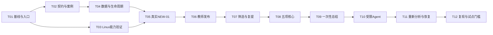

# 知因 CodeLab 实施顺序与框架验收 V1.0

最新增量（2026-09-28）：T10—T11 有界 Agent、独立补查/重新分析和真正检查点已接入并完成工程验证；T12 本地恢复、恢复库 HTTP、非空检查点恢复与评测登记已有证据。下方开篇为较早快照；完整系统隔离、独立成员及真实模型/教师质量仍未验收，任务条款不变。当前以 [实施状态](../IMPLEMENTATION_STATUS.md) 顶部增量为准。

日期：2026-09-27；进度更新 2026-09-28。状态：实施中。T01—T06 的受控开发路径已接通；T07 筛选、复提及旧报告保留已实跑；T08 五项八案例、11 份样本和第二实现已完成工程验证。T09 的真实模型配置、总结/Agent 配对调用、候选隔离、精简反馈和异常降级已完成工程验收；模型费用、独立事实核查与教学质量仍待完成。T10—T11 的受限 Agent、持久检查点和恢复已接入并验证。独立评阅、完整隔离及课程试点未通过。当前结果见 [实施与验证状态](../IMPLEMENTATION_STATUS.md)，下文验收条款继续作为后续实施依据。

依据：[工程启动蓝图](../../output/知因CodeLab_工程启动蓝图_V1.0_2026-09-27.md)、[四组关键契约](CONTRACTS_V1.md)、[V3.0 参赛方案](../../output/知因CodeLab_最优参赛方案_V3.0_2026-09-27.md)。若任务文字与字段名称不一致，以本版契约为实现依据，并修正文档后再交接。

## 1. 工作原则与责任

目标是形成一套经过真实链路验证的工程基础。实施以小切片串联各层：每一切片包含协议、数据、执行、展示和必要验证，避免平台、执行器与 Agent 长时间分别开发后才接线。

| 角色          | 主责                                                            | 共同责任                                                 |
| ------------- | --------------------------------------------------------------- | -------------------------------------------------------- |
| A：平台与集成 | 数据协议汇总、增量迁移、API、证据存档、教师复核、学生访问与复验 | 与 B 一起审查协议、隔离边界和首次真实链路                |
| B：执行与分析 | Linux runner、浏览器案例、探查、模型适配、预算与恢复            | 与 A 保持版本、字段、deadline 和证据交接一致             |
| C：需求与验证 | 课程行为、样本登记、人工真值、评测、成果证据和材料              | A/B 协助编写复杂检查；C 不被假定可以独立完成全部测试代码 |

A/B/C 是角色。实际成员姓名、可投入时间和资源在实施开始时登记；只有一人时仍按顺序完成相同交接物。每轮指定一个集成负责人，使用相同代码版本、包哈希与运行编号核对结果。

任何运行记录必须标明来源：`ui_fixture`（合成报告）、`constructed_execution`（团队样本实际执行）、`authorized_submission`（授权真实提交）。来源不能在导出和答辩时改名。

## 2. 依赖顺序与阶段门槛



T02 与 T03 可并行；T06 的界面和权限夹具开发可在 T04 后并行，最终验收依赖 T05 的真实报告。T08 完成前可以独立准备模型配置和受控测试，但不提前宣称模型已建立在可靠真实结果上。

| 门槛            | 对应任务               | 通过后可以声明                                 |
| --------------- | ---------------------- | ---------------------------------------------- |
| G0 设计可评审   | 本轮三份文档           | 有明确的范围、架构、契约和实施计划             |
| G1 真实小闭环   | T01—T07                | 指定开发案例的真实检查、证据、发布与复提可运行 |
| G2 基础检查可靠 | T08，并保持前序验收    | 五项核心在登记样本和条件内获得验证             |
| G3 分析可控     | T09—T11                | 真实模型与受限探查有可追溯结果、费用和失败处理 |
| G4 授权试点条件 | T12 工程门槛与外部授权 | 允许进入限定课程试用；节时与复用仍需实测       |

时间安排以正式截止日、人员与环境为输入。没有这些事实时只固定依赖和验收，不承诺某日期自动完成试点。若只达到 G1，就按受控开发切片展示，不宣称五项或完整 Agent 已验证。

## 3. 可交接的开发任务

### T01 保存现有基线，统一工程入口

- 负责人：A；依赖：G0。
- 范围：根配置、README、环境示例、工作区清单与现有验证记录。
- 工作：保存可恢复的源码和必要数据基线；登记未跟踪文件及现有修改；选定实际可用的 Node/pnpm 版本；校验环境变量入口；列明业务、worker、runner 的运行方式和端口。
- 保留首版 `tsx` 服务运行方式；`pnpm build` 仍准确称为网页构建。服务要增加独立启动冒烟与镜像内模块加载检查，不以网页构建成功替代。
- 交接物：环境清单、版本记录、基线恢复说明、开发命令表、当前失败或未验证项。
- 验收：在未破坏现有目录和数据的前提下，冻结安装、类型检查和既有测试能复现其实际结果；README 命令与真实脚本一致。失败照实记录并归因，不照抄历史“34 项通过”。
- 明确不做：顺便改主题、扩页面、替换框架或升级全部依赖。

### T02 落实 C1/C2 契约与第一批开发样本

- 负责人：A/B，C 负责行为与真值；依赖：T01。
- 范围：`packages/contracts`、任务包定义、执行样本登记和有意义的契约测试。
- 工作：保留条目内部 ID，增加显示码和案例；区分计划步骤与执行轨迹；实现错误分类、聚合、证据范围、源码清单和指纹结构；定义 runner 协议版本和幂等动作身份。
- 先创建 `NEW-01` 开发包，其后为 `NEW-01 + FILTER-03` 新建开发包。完整课程包按八案例矩阵另定版本，不把开发包冒充完整包。
- 交接物：可校验的请求/响应样例；至少正常、明确失败、前置受阻、坏引用四类样例；原始 ZIP 与源码清单哈希算法的固定输入输出。
- 验收：未知案例、重复案例、空自动条目、跨案例引用、哈希不符被拒绝；合法运行级构建日志引用允许；聚合覆盖失败与未执行并存的情况。
- 样本：已有 correct/filter-defect/build-error 可继续用；额外构造漏新增或重复新增、筛选准备受阻样本，明确它们属于开发家族。

### T03 验证 Linux 执行与回收的实际能力

2026-09-27 环境安排更新：用户已停止博物馆并授权复用现有 Docker Desktop。先使用独立 CodeLab 容器、网络和数据卷完成 Linux 协调器、独立回收进程与团队样本的真实接线；结果登记为 **Docker Desktop 开发验证**。该路径不再以新增 Linux 主机为开发前提，原有专用环境隔离、浏览器沙箱及故障恢复条款仍逐项保留，不能因暂停博物馆而自动通过。

- 负责人：B，A 复核；依赖：T01，可与 T02 并行。
- 范围：部署说明、三个执行镜像与可信控制镜像、runner 通道、持久临时任务元数据和独立回收入口。
- 工作：登记 VM、内核、Docker/cgroup、磁盘与网络；构建并锁定三个实际镜像；校验固定 Chromium；配置受控通信和服务身份；确认业务容器内的 loopback 不是远端 VM。
- 先在团队构造样本环境验证网络边界、基础资源上限与回收。`RUNNER_APPROVED` 只表示管理员明确启动该测试环境，不能代替安全验收；业务入口保持受控。
- 交接物：实际镜像摘要、capabilities/readiness 响应、正确项目静态页面可访问记录、受限通道及资源清理记录。
- 验收：可信协调器能调用 Docker；学生和浏览器容器不持有控制凭据、数据库或模型密钥；runner 进程退出后独立回收仍工作；残留未清时拒绝新任务。
- 受阻处理：没有 Linux 或镜像运行失败时输出具体失败证据；继续 T02/T04 的协议及数据库工作，不用 UI 夹具替代执行验收。

### T04 建立增量数据结构与生命周期

- 负责人：A，B 检查所有权；依赖：T02。
- 范围：`db.ts/migrate.ts/schema.ts`、新增 SQL 迁移、`queue.ts`、运行 API 和旧读取适配器。
- 工作：增加迁移台账及五类增量表；新 Run 只表示基础检查；ExecutionAttempt 持有首次资源与租约；AnalysisAttempt 独立预算；原始结果单次封存；旧报告保留读取。
- 统一提交、运行和发布的学生/任务事务锁顺序。任务领取、心跳、过期处理与封存有明确竞争规则。
- 交接物：迁移文件、空库/旧库升级记录、状态转换测试、旧报告读取截图或响应、新协议 API 样例。
- 验收：重复迁移无变化；迁移失败不登记完成；旧报告内容及哈希不变；终态 Run 不能重开；迟到 owner 写入被拒绝；封存后的基础字段不能因 owner 仍存活而改写。
- 注意：新结构采用协议版本分支，避免同时维护新旧两套可写结果数组。

### T05 打通 NEW-01 的真实检查与持久证据

- 负责人：B 执行、A 存档；依赖：T03、T04。
- 范围：worker、runner、浏览器检查脚本、证据存储和运行查询。
- 工作：从实际上传 ZIP 创建提交和 Run；只启用 NEW-01；校验真实源码清单与实际指纹；记录前后数量、唯一标题和实际步骤；持久基础结果后生成确定性报告。
- 所有协议/环境错误与功能失败分开；worker 在基础封存后的任何失败都不能进入覆盖原始结果的处理分支。
- 交接物：正确、明确新增缺陷、构建失败三个样本的真实运行目录；每份包含输入哈希、运行/尝试编号、环境、清单、日志及结果。
- 验收：正确样本通过；漏新增/重复新增失败；构建失败的 NEW-01 为未执行；同一 HTTP 动作重放不重复执行；重启或超时留下明确状态和回收凭证。
- 不依赖：模型服务；本任务完成仍不能声明教师发布闭环已经完成。

### T06 完成教师复核、判断和版本化发布

- 负责人：A，C 复核内容；依赖：T04，最终验收依赖 T05。
- 范围：报告修订与发布 API、教师报告页、学生报告与证据入口。
- 工作：原始结果和教师判断分开；每次编辑追加修订；确认绑定内容哈希；发布绑定确定修订和证据白名单；保留无模型发布路径。
- 为开发任务增加一条明确的人工教学项，验证人工判断从 manual 到教师结论的正向路径。新增人工项需新规则；沿用旧规则的记录不受影响。
- 交接物：真实基础报告的教师修改、判断、确认、发布及学生读取记录；重复发布、旧修订冲突和越权反例。
- 验收：学生发布前不可读草稿和内部证据；发布后只读本人公开快照；教师确认未执行不会变成自动通过；自动更正保留原始事实；内容编辑会使对应确认失效。
- 历史更正：新建修订和 publicationNo，保留旧内容；学生有新提交时，更正仍属于旧提交，不能提升为最新报告。

### T07 扩展 FILTER-03，验证受阻与复提

- 负责人：B 案例、A 比较、C 样本；依赖：T05、T06。
- 范围：新开发包、筛选检查、准备步骤、比较 API 与页面。
- 工作：在本案例独立准备完成 A/未完成 B；验证初始全部→已完成。正确、筛选缺陷、准备失败分别得到 passed、failed、not_run。
- 在同一包/规则/指纹下执行缺陷与修复两份提交；每次重跑全部已启用案例。增加一个已通过案例回归的样本，验证结果变化不会互相遮蔽。
- 交接物：前后提交及运行对、实际指纹、失败与修复截图、准备受阻轨迹、旧报告可读证据。
- 验收：筛选的准备失败不算筛选功能失败；不存在的执行步骤不会出现在“已完成”列表；同条件比较正确；改变包或镜像后显示不兼容且没有修复/回归标签。
- 完成 T01—T07 才能标记 G1。G1 只说明登记开发案例的受控真实闭环成立。

### T08 扩展五项核心与基础可靠性

- 负责人：B 检查、A 聚合与页面、C 独立真值；依赖：T07。
- 范围：正式首版任务包、八个案例、人工项、案例级复验、样本覆盖。
- 工作：新增→空值/空格校验→双向状态→三种独立筛选→刷新保留；逐项验证上下文独立、前置、真实步骤、哈希与聚合。
- 至少准备两份内部结构不同、同样满足公开交互约定的正确实现；换标题、换颜色不计独立实现。C 按教学行为核对结果，不能直接把测试输出抄成真值。
- 交接物：案例×正常/缺陷/边界/受阻覆盖矩阵；原始计数及未覆盖范围；五项真实结果和修复/保留/回归对照。
- 验收：八个启用案例都有独立结果；空自动条目不能通过；无明确失败但有必需未执行时不显示全部满足；人工项没有虚构机器判定。
- G2 验收只支持登记任务和样本，不推出通用项目准确率。

### T09 接真实一次性总结 S

- 负责人：B，C 评阅，A 维护修订；依赖：T08。
- 范围：模型适配、最小证据输入、来源绑定、真实费用、候选草稿。
- 工作：先用固定基础证据执行一次性总结，保留模型原始输出、实际配置和用量；严格校验结构与引用；验证无 key、403、超时、坏输出的基础报告路径。
- 模型凭据通过受控配置提供，不写到文档、公开日志或样本。发送真实学生材料前需要相应授权；本阶段使用团队样本。
- 交接物：至少一份真实请求/响应的脱敏记录、计费配置、引用与事实人工核查、教师修订记录。真实服务失败也记录，不以 mock 改名为实调用。
- 验收：模型只生成候选；教师已修改时不覆盖；坏引用被拒绝；模型失败仍能发布基础反馈；明确模型实际接收的是文本/图片中的哪一种。

### T10 加入一个受控调查 Agent A

- 负责人：B，A 检查边界，C 评价新增事实；依赖：T09。
- 范围：六工具、预置 FILTER_ORDER_CHECK、预算台账、补充清单和分析候选。
- 工作：删除模型到动作数组的通路；工具只接受任务包目录和有界参数；实现 4/6/1/90 的初始保护配置；持久预留调用预算，补查证据另存。
- S 与 A 从相同基础证据出发，分别保留输出。A 有新增证据时说明具体多知道了什么；无新增或不值得探查也计入结果。
- 交接物：工具轨迹、真实新增观察、未探查/阻塞/超预算案例、模型费用、教师修改和基础结果封存哈希。
- 验收：模型不能传 URL、脚本或选择器；超过额度拒绝；源码/日志里的扩权或发布指令无效；探查成功不覆盖基础失败；已有基础覆盖路径不能冒充新发现。
- 价值边界：一次真实成功案例只证明该路径可运行，调查收益需要评测，不能直接写成“优于一次性总结”。

### T11 完成显式重新分析与故障恢复

- 负责人：A/B；依赖：T10。基础回收与写隔离已在 T03—T05 开始验证，本任务补完整分析链路。
- 范围：独立 reanalysis owner、检查点身份、超时预算、调用 unknown、取消、恢复和历史更正竞争。
- 工作：显式重新分析产生新 ID；读取存档，不重写基础 Run；有预算才重建探查环境；初始和重新分析使用各自期限且回收不重复扣减。
- 交接物：在基础封存前/后、调用发送后、候选提交前、回收时注入中断的记录；每次包含旧 owner、预算、结果和资源最终状态。
- 验收：Run 完成但资源未回收时不接下一项；租约过期拒绝晚到结果；模型 unknown 不静默重试；用户重新分析不会覆盖教师较新修订或发布；回收失败产生可见阻塞。
- 新 Run 与新 AnalysisAttempt 的按钮及 API 含义明确，不用一个“重试”按钮混合两种动作。

### T12 第二成员复现、工程门槛与评测登记

- 负责人：A/B 工程，C 证据与外部条件；依赖：T08—T11。
- 范围：干净环境、运行边界、文档同步、成果索引、授权试点和评测准备。
- 工作：第二成员按说明安装和运行；复核网络/宿主/元数据/跨任务隔离、真实沙箱策略、资源耗尽、ZIP/产物边界、越权和备份恢复；按当前配置留存证据。
- 更新 README、部署、实施状态和评测文档，明确新旧基线。保留历史测试边界，不覆盖旧日期使其看起来像新测试。
- 评测采用 H 人工、R 结构化报告、S 一次性总结、A 受限 Agent。30 个版本的 12/6/12 是后续建议目标，初赛记录实际覆盖，开发/演示家族不流入冻结集。
- 教师计时、模型多轮重复、检查可靠性分别记录；H 使用正常开发工具和合理缓存，所有组以形成同等质量可发布反馈为终点。
- 交接物：干净环境复现、门槛报告、授权与教师标准、样本登记、原始结果、费用和未覆盖项；若没有授权则停留于团队样本受控原型。
- 验收：完成的主张逐一有证据；G4 未通过时保持真实学生入口受控，未测指标保留待采集。

## 4. 验收矩阵：必须实际观察到的行为

| 编号 | 场景和动作                         | 通过条件                                                                | 所属任务/门槛 |
| ---- | ---------------------------------- | ----------------------------------------------------------------------- | ------------- |
| F-01 | 正确 NEW-01                        | 数量恰好加一、唯一标题和真实轨迹                                        | T05/G1        |
| F-02 | 漏新增或重复新增                   | 明确失败，证据支持具体差异                                              | T05/G1        |
| F-03 | 构建失败                           | 案例未执行，日志归属正确，无功能误判                                    | T05/G1        |
| F-04 | FILTER-03 准备失败                 | not_run＋本案例 blockedBy                                               | T07/G1        |
| F-05 | 检查早期中断                       | 后续未发生步骤明确未执行                                                | T05/T07       |
| F-06 | 真实基础报告发布                   | 教师确认后学生本人可读公开证据                                          | T06/G1        |
| F-07 | 模型未配置或异常                   | 原始结果、基础报告、发布保持可用                                        | T06/T09       |
| F-08 | 新提交和再次检查                   | 新身份、全量启用案例重跑、旧报告保留                                    | T07/G1        |
| F-09 | 包/环境变化或旧记录缺字段          | 不自动标修复或回归                                                      | T07/T08       |
| F-10 | 人工项、更正自动误判               | 原始/教师结论分开；准备受阻后教师人工确认失败可正常聚合；确认不等于通过 | T06/T08       |
| F-11 | 教师编辑后模型候选到达             | 当前修订不被覆盖，候选可明确采纳                                        | T09/T11       |
| F-12 | 相同发布请求重发                   | 返回同一 Publication；变载荷冲突                                        | T06           |
| F-13 | 编辑后沿用旧确认                   | 发布被拒；重新确认当前内容才成功                                        | T06           |
| F-14 | 新提交与旧草稿发布并发             | 同一事务锁保证旧 latest 发布被拒                                        | T06/T11       |
| F-15 | 历史发布更正及伪造更正用途         | 新 publicationNo；旧快照可读；不提升旧提交；从未发布或前序已变化时拒绝  | T06/T11       |
| F-16 | 同运行不同案例/跨学生证据          | 服务端拒绝错误归属；合法运行级日志可引用                                | T02/T06       |
| F-17 | 补查成功与基础失败矛盾             | 保留两条事实，基础封存哈希不变                                          | T10           |
| F-18 | 重发外部 operation、超限和 unknown | 不重复执行、不重置预算、不伪填零费用                                    | T10/T11       |
| F-19 | worker/runner 被终止               | 保留已封存结果、旧 owner 写拒绝、独立清理                               | T05/T11       |
| F-20 | 数据库租约过期但容器尚在           | cleanup_pending 阻止接单，回收确认后恢复                                | T03/T11       |
| F-21 | 实际网络与资源攻击样本             | 禁止目的地不可达；超限能结束并清理                                      | T03/T12/G4    |
| F-22 | 空库、旧库、重复迁移和恢复         | 新旧数据可读，旧快照未被重写                                            | T04/T12       |
| F-23 | 第二成员干净环境复现               | 固定样本得到可解释的实际结果和版本记录                                  | T12           |
| F-24 | 合成/构造/真实来源检查             | 统计和材料中的分母、来源与证据一致                                      | 全程/T12      |
| F-25 | 初始化失败或未封存即失租           | 受限恢复记录未知环境与未执行，无伪造步骤；教师可发布故障说明            | T04/T05/T11   |
| F-26 | 执行与独立分析同时领取             | 共用全局锁只领取一项；排队分析不占活动槽，回收未完成仍占槽              | T04/T11       |

这张表是验收需求，不是运行结果。执行后另填日期、代码版本、环境、输入哈希、预期、实际、证据地址和检查人。

## 5. 样本与证据交付方式

### 5.1 最小开发样本清单

| 样本标签                          | 用途                               | 当前状态                                            |
| --------------------------------- | ---------------------------------- | --------------------------------------------------- |
| correct                           | 已有正确参考输入，需真实复核其行为 | NEW-01 实际 passed；其余案例待 T07/T08             |
| filter-defect                     | 筛选缺陷与修复复验                 | 已生成登记；真实结果待 T07                          |
| build-error                       | 构建失败与未执行分类               | 实际 build_error，NEW-01 为 not_run，零案例步骤    |
| create-missing / create-duplicate | NEW-01 负例                        | 两份真实执行均 failed，分别观察数量变化 0 和 2     |
| filter-setup-blocked              | 前置准备失败                       | 已构造登记；筛选自己的真实准备轨迹待 T07            |
| fixed-with-regression             | 修复筛选、持久化出现回归           | 已构造登记；SAVE-01 须在 T08 启用，属于同一开发家族 |
| correct-independent               | 不同内部结构的正确实现             | 待实现与人工核验                                    |

来源登记包含 sampleId、实现家族、源码关系、用途分区、授权、哈希、预期案例结果及真值依据。一个家族的缺陷和修复版本不能分散到开发与冻结测试分区。

当前共 7 份 ZIP、1 个开发家族；原始输入登记中的预期矩阵保持 `expected-only`，其中 4 份另有真实 NEW-01 执行记录。输入字节、准入和源码构造验证见 [T02 记录](../verification/2026-09-27/T02-contracts-samples.md)，实际执行、证据和发布见 [T03—T06 Desktop 记录](../verification/2026-09-27/T03-T06-desktop-v2.md)。两种材料独立保存，不把预期字段复制为实测。

### 5.2 每次真实执行的证据包

后续建议在受控位置保存 `docs/verification/<日期>/<runId>/` 的索引，原始私有证据可以存放在工作区外的受控目录；不要为了文档链接把学生源码和密钥复制进公开仓库。

```text
verification-record.md     本次预期、实际、结论、未覆盖项
environment.json           实际系统、镜像、浏览器、包和规则版本
input-manifest.json        ZIP/源码哈希、样本来源与案例清单
result-manifest.json       原始结果、证据哈希与保存状态
execution-events.jsonl     脱敏阶段轨迹、owner、操作和计时
publication-reference.json 发布ID/修订ID与公开证据引用
```

文件名是推荐结构。本轮已有团队构造源码的真实证据包：[desktop-v2-1d4413b7-474/results.json](../verification/2026-09-27/desktop-v2-1d4413b7-474/results.json) 联合四份 `*-response.json` 和实际日志/观察/截图，覆盖环境、输入、身份、结果、发布与回收。没有真实学生授权提交。已有基线、契约、数据库、runner 准备及合成报告界面的历史验证记录保留，各自标明来源。日志、截图与模型原始输出按留存与访问规则另存；索引必须能解析到真实文件或受控服务对象。

验收记录模板：

```text
场景编号：F-xx
日期与检查人：待执行
代码版本 / 未提交差异摘要：待执行
样本来源、原ZIP哈希、源码清单哈希：待执行
规则 / 包 / 镜像 / 浏览器指纹：待执行
runId / executionAttemptId / analysisAttemptId：待执行
预期：引用契约中的行为
实际：保留真实结果，失败同样记录
证据：步骤、日志、截图、清单、发布与回收记录
结论：通过 / 失败 / 受阻 / 未执行
限制与下一步：具体填写
```

## 6. 文档、代码与测试的完成规则

一项任务完成需要：实现满足契约、相应测试或真实验收通过、原始证据可定位、文档已更新、未覆盖事项明确。涉及 Linux 隔离或真实模型时，单元测试只能证明部分逻辑，不能替代系统验收。

运行既有回归以识别退化；新增测试聚焦跨模块不变量、错误分类、并发、权限和真实用户路径。不要为字段搬动机械复制实现测试，也不为文档排版改动跑全部服务测试。

各验证层分开记录：

| 层次       | 方法                                     | 不得推导的结论                   |
| ---------- | ---------------------------------------- | -------------------------------- |
| 类型和构建 | 类型检查、网页构建、服务加载             | 不代表真实模型或容器可用         |
| 业务测试   | API、数据库事务、合成报告界面            | 不代表学生项目实际检查过         |
| 真实执行   | Linux 执行环境、固定镜像、真实 ZIP、Chromium | Desktop 开发验证不自动代表完全隔离或任意项目兼容 |
| 模型验证   | 实际供应商、输入、用量、人工评阅         | 不凭结构合法推定事实正确         |
| 课程试用   | 授权真实任务、教师操作和再次使用         | 不由小样本通过率推断学习效果     |

结束一轮开发时输出：本轮完成任务、变更文件、实际检查结果、证据编号、仍未通过的门槛、下一项可执行任务。新的设计决策应先更新蓝图和契约，再调整消费者，避免方案与代码各自演进。

## 7. 当前实施入口（2026-09-28 更新）

| 任务 | 当前工程状态 | 仍需完成的验收 |
| --- | --- | --- |
| T01—T07 | 持久工作台、真实执行、教师发布、学生读取和复提比较已接通 | 独立成员复现另列 T12 |
| T08 | 五项核心、八案例、11 份开发 ZIP、两种实现家族已验证 | 独立教师真值尚未收集，不能推出通用准确率 |
| T09 | 真实模型总结与 Agent 已在同一团队样本完成配对工程调用；候选、原始 I/O、用量和失败记录已隔离保存 | 真实费用、事实核查和教师独立复核；不能据此声明教学质量 |
| T10 | 六工具 Agent、固定补查、预算与证据保留已实现；真实 Agent 已完成一次同存档配对调用；私有材料 ZIP 和账本材料映射已接通 | 真实模型效果；预登记试验、独立评价、分组教师修订与发布仍需真实采集 |
| T11 | 独立重新分析、持久检查点、租约与已测中断恢复已实现 | 完整故障矩阵不等于已覆盖，更多宿主/服务中断仍需验证 |
| T12 | 本机复现、备份恢复、资源限制、容量预留、评测账本、历史引用/文件检查及持久专项保留登记已提供 | 授权历史回收、独立存储/生产隔离、第二成员、教师评测及授权试点 |

日常入口为 B 版工作台 `http://127.0.0.1:5174/`，完整用户操作见 [操作路线](../QUICKSTART.md)。最新逐轮证据见 [实施状态](../IMPLEMENTATION_STATUS.md)。总体项目与 G4 不标记完成；已有受控工程结果不替代真实模型、独立人员和生产环境验收。

工程优先项：继续未验恢复/隔离和引用感知保留机制。配对材料可通过报告页下载，依据 [评测记录](../EVALUATION_RECORDS.md) 连接预登记账本；人工数据不会自动代填。外部模型和人员条件具备后，按协议实际采集，而不是把合成记录改名。

### 2026-09-27 历史实施入口（保留，不作为当前待办）

| 任务    | 当前状态                                  | 交接与剩余依赖                                                                         |
| ------- | ----------------------------------------- | -------------------------------------------------------------------------------------- |
| T01     | 基线与入口验证通过                        | 可恢复归档、冻结安装、原有回归及服务冒烟；保留原 3100/5173 预览                        |
| T02     | 核心契约和 7 份样本已实现验证             | C1/C2、C3 与样本测试；C2 心跳/HTTP 已接线，实际检查器和环境身份已测量 |
| T03     | Docker Desktop 开发路径通过              | 四镜像、Linux runner/独立 reaper、HTTP/worker 与真实退出回收已验；完整隔离和故障矩阵待后续 |
| T04     | 数据、生命周期及真实存档接线通过          | PostgreSQL 71/71；源码身份复核、实际归档后封存、旧 owner 隔离；完整崩溃矩阵待 T11/T12 |
| T05     | 四份团队样本的 NEW-01 真实链路通过        | 正常 passed、两种新增缺陷 failed、构建错误 not_run；11 份证据；单 execute 和恢复查询已验 |
| T06     | 实际报告的接口修改/确认/发布/读取通过      | 四份实际报告由生成账号完成走查；界面另有 ui_fixture E2E；没有真实教师评价 |
| T07—T12 | T07 是下一项，尚未验收                    | 按依赖顺序推进筛选复提、五项核心、真实模型、受限 Agent、完整恢复和复现 |

下一步为 **T07：NEW-01＋FILTER-03、准备受阻和同条件复提比较**。本轮实际接线、恢复范围与未验边界见 [Desktop 验收记录](../verification/2026-09-27/T03-T06-desktop-v2.md)；原 [runner 准备记录](../verification/2026-09-27/T03-runner-preparation.md) 保留为历史快照，不再以新增专用主机为团队样本开发前提。模型接入按 T09、前置 T08 执行；前端视觉优化留待用户后续安排，当前优先保证业务路径可操作。

继续实现时直接引用任务编号和契约条款，不重新选择技术栈，也不把合成报告或单元测试结果提升为 G1 真实闭环。
