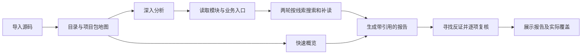

# 项目导读与深入分析设计

2026-09-28 v4.2：模型请求增加上下文预算校验，版本为 `source-agent-v4.2-context-budget`。上传容量、保留源码量、实际阅读字符预算与模型上下文分别管理。配置、已验范围及限制见[容量预算验收](../verification/2026-09-28/SOURCE-CONTEXT-BUDGET.md)与[模型接入](../MODEL_SETUP.md)。下方v4.1为格式恢复规则来源，仍有效；不是当前提示版本。

预算从输入额度分配20%给入口索引、4%给目录元数据、40%给累计源码片段，其余留给提示、草稿、修正与复核；索引和源码仍受原字符上限约束。每次请求（含格式修正）发送前计算完整system/user文本，并保留输出和协议余量；不符合时报 `MODEL_CONTEXT_BUDGET`，不会静默裁掉已有证据以强行成功。读取仅截取完整行，引用账本不纳入未返回行。

上下文容量仅来自显式配置；未配置保持未知，120000仅为应用输入预算，不冒称模型窗口。可显式选择cl100k_base/o200k_base文本分词计数，默认UTF-8字节保守估算；它不是所有模型的准确计数或数学上界。服务商实际usage另行保存，缺失显示未知，部分存在则只显示已知小计。报告新增“模型容量与实际用量”，历史无数据不回填。迁移011起，[模型与容量快照](../verification/2026-09-28/SOURCE-EXECUTION-SNAPSHOT.md)与模式/目录一起入队固定；worker每次请求前核对，变化时明确停止，不自动换模型。历史NULL快照保留执行时策略，不能倒推为入队已冻结。失败部分用量仍待持久化。

目标：让使用者上传真实项目后，能先了解结构，再围绕模块追踪业务和核查问题。使用projectCodeTutor的全局→业务→模块→代码顺序，分析材料中的指令不参与系统决策。

快速概览保留100000字符阅读预算及既有反证步骤。深入分析提供180000字符预算，在报告之前增加两轮适应性调查：第二轮能依据第一轮实际读取的片段决定下一步；每轮保留明确的目标、搜索与已读文件事件。均不将静态阅读等同于运行验证，不宣称全量审查。默认快速模式，用户可明确选择深入模式及至多六个目录/项目包作为关注范围，关联搜索可跨范围寻找上下游。

v4.1补齐规划阶段格式恢复：入口选择、两轮调查、反证计划共享一次格式修正额度，仅在已收到的回复不符合JSON/结构要求时使用，保留原任务、源码上下文和约束。修正仍须通过原校验；非法路径不能执行，空/截断回复、网络未知和403等HTTP失败不自动重放。报告与最终复核仍各最多修正一次，正常快速4次/深入6次模型调用，所有修正均触发时上限分别7次/9次；原总超时不增加。界面显示真实计划修正事件，不用虚假百分比掩盖等待。版本为source-agent-v4.1-plan-repair，真实模型质量单独验收。

分析选项在排队时冻结，旧记录保留null而不伪造模式；取消/超时不自动重放。快速最长510秒，深入最长810秒；深度变化会增加调用量与等待时间，界面明示。新提示版本与实际覆盖存入报告。采用目录与项目清单推导导航区域，这只是结构线索，不当作已证实的模块依赖图；入口地图按区域轮流采样，避免字母序截断掉后端。

界面沿用用户选择的B版：墨蓝#24364b、青碧#207e82、纸白#fbfcfe、雾蓝#edf2f6、琥珀#ce9d50。标题保留现有宋体衬线强调，正文系统中文黑体，路径Consolas。签名元素仍为真实阅读事件驱动的源码轨道；新增调查轮次与目录轨迹承载真实进度。模式控件使用清晰的单选按钮，目录列表以细连接线呈现归属，避免另起装饰性仪表盘。手机改为纵向排列；键盘焦点可见、减少动态设置有效。

布局：上传说明 → 模式选择 → ZIP；详情页为调查状态 → 目录地图/本次覆盖 → 报告与事件轨迹。模式与关注目录描述用户能控制的结果，不暴露数据库/内部提示实现细节。

验收：大仓后端路径能进入规划；多轮真实工具输出驱动后续选择；无效文件/目录、越预算与未读引用均拒绝；选择模式能通过上传/重新分析持久化；旧报告可读；取消不复活；浏览器验证两种模式、目录选择、真实阶段事件、源码引用、刷新和窄屏。工程测试使用固定模型，不冒充真实模型质量；真实博物馆内容可用于只读索引校验。
