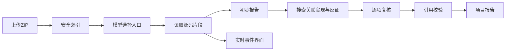

# 普通 ZIP 项目分析

2026-09-28迁移011增量：[模型与容量快照](../verification/2026-09-28/SOURCE-EXECUTION-SNAPSHOT.md)在上传/重新分析入队事务内固定；数据库禁止修改，每次模型请求前检测配置变化，明确停止且不重放。历史NULL不补造。该增量不扩大阅读预算，也不改变v4.2提示版本；失败部分用量与真实质量仍未完成。

2026-09-28 v4.2增量：已实现模型感知的输入/输出/安全余量预算、完整行限额读取与真实usage/估算分离。详见[当前模式契约](SOURCE_ANALYSIS_MODES.md)、[容量预算验收](../verification/2026-09-28/SOURCE-CONTEXT-BUDGET.md)。100MiB上传限制与模型token窗口无直接换算关系；仍不代表全部源码读完。当前不自动切换模型，DeepSeek实际适配和质量/费用对照未完成。下面v4.1/v4/v3描述均是历史增量，受本节当前规则补充。

2026-09-28 v4.1增量：规划阶段新增共享一次格式修正额度，快速正常4/最多7次、深入正常6/最多9次模型调用，总超时保持510/810秒；仅修正已完成的结构错误回复，不自动重放网络或HTTP失败。详见[当前模式契约](SOURCE_ANALYSIS_MODES.md)。博物馆真实深入调用首次遇到计划格式错误，修复后再验遇到供应商403，尚未得到v4.1真实成功报告；不能用隔离夹具成功替代。

2026-09-28 v4增量：[快速/深入设计](SOURCE_ANALYSIS_MODES.md)及[验收](../verification/2026-09-28/SOURCE-ANALYSIS-MODES.md)优先于下方历史v3预算描述。快速100000字符，深入180000字符并追加两轮调查；均衡索引最多1200路径/48000个JSON字符，最多6个重点目录，选项排队时冻结、历史NULL。当前迁移010、源码提示source-agent-v4-module-investigation，未切换模型，固定测试回复不代表真实质量验收。

## 需求理解
上传普通源码 ZIP 即开始 AI 分析，不要求课程、验收规则或 Vue 模板。采用 projectCodeTutor 的全景→业务→模块→代码阅读顺序。保留原有实训验收入口，其模板和运行隔离约束不变。

## 影响范围与最小路径
独立 source_projects/source_analyses 表、owner 私有 API、进程托管工作循环、项目分析页面。原课程运行队列、证据、教师发布不变。源码任务不启动 Docker；41724 锁限制单个运行状态的源码任务，独立于课程执行器。v2 正常四次模型调用：选择文件、初步报告、补查计划、复核报告；初稿结构/引用不合格、复核输出不合格各最多增加一次修复（最多六次调用，不自动重试网络失败）。复核仅返回逐条决策和必要的报告修改，不重复生成无变化段落。执行时限510秒，数据库任务期限九分钟，过期标中断，不自动重放可能付费的请求。取消、失败和过期状态禁止迟到结果发布。修复不允许程序伪造、截短或替换引用来使报告过关。

2026-09-28容量升级：普通ZIP最大100MiB、20,000条目、展开500MiB（包括跳过项），保留源码16MiB/单文件512KiB。依赖、产物、二进制、敏感配置被排除并展示原因。先流式写入私有临时ZIP并计算SHA，再由磁盘随机读取条目；不落盘解压目录、不执行脚本。每个API进程最多两个同时导入，请求最长两分钟，写入前检查临时盘和配置存储盘余量；成功/失败/超时/连接中断正常进入清理，硬杀/宿主故障下的临时ZIP回收仍需完善。额外multipart字段/附件在入库前拒绝；课程入口仍保持10MiB。源码仍以有界JSONB保存，尚未采用对象存储或全仓库按需索引。见[实测](../verification/2026-09-28/SOURCE-IMPORT-100MB.md)。

常见密钥模式脱敏不是完整秘密检测；上传前仍应移除敏感信息。入口规划文件地图最多1200条；首次最多选择12文件的前180行。补查计划最多6次字面关键词搜索（每次最多30处匹配）和6次指定行段读取，再跟随命中读取最多6个文件的上下文。所有读取共享100000字符预算，单次最多7000字符，仅完整返回的行计入引用范围；分离行段之间的空白不算已读，搜索预览不能直接用作引用。新报告持久化规划路径数、导入文件/行数、已读文件/唯一行数和累计读取字符数（含重复读取及行号）；覆盖不等于正确率。历史报告没有新增统计时明确提示，不伪造回填。文件地图可筛选，文件/跳过列表分批显示100项，避免一次渲染20,000行。相同ZIP重传仍返回原项目，不升级旧项目的源码快照。

复核结果逐条对应初步问题，下标必须唯一且完整；区分 retained（保留线索）、withdrawn（撤回）、unresolved（仍待核实）。最终建议由已复核条目构建，撤回项保存在复核记录中，待核实项强制为 hypothesis。无问题的初稿仍进行业务链路补查，不以“零建议”证明安全。引用校验确认出处实际读过，不自动证明语义正确。报告保留抽样、截断、静态分析边界，没有运行测试的报告不得作为实训通过证明。旧版报告没有复核记录，页面明确提示，不回填伪造历史。

## 视觉契约

v3新增补读公平性：六组搜索轮流取上下文，避免第一组命中耗尽六个文件名额。首次阅读最多占60000字符，指定补读后仍为搜索保留21000字符，每个搜索上下文最多3500字符，整体100000字符上限不变。提示要求实现断言引用对应实现、区分执行时机和调用链；这是模型约束，不是自动语义证明。v3.1将复核返回的modules/flows/readingPath按原title逐项合并，保留未修改条目，避免局部更正清空其他模块。旧版持久化报告不回写，既有证据版本保留。

当前配置的 `qwen3.8-flash` 按[官方深度思考文档](https://help.aliyun.com/zh/model-studio/deep-thinking)支持混合思考，默认开启。源码分析对这个精确模型名显式发送 `enable_thinking=false`，直接生成结构化内容，再通过独立补查/复核判断；不改变课程分析默认参数，不给其他模型添加供应商专属字段。正常结果记录每次请求时长、实际用量（缺失保留null）、请求ID与该模式；不收集或展示内部思考。设置变更本身不证明延迟或质量达标，须结合实测。
主色：墨蓝 #24364b、雾蓝 #edf2f6、纸白 #fbfcfe、青碧 #207e82、琥珀 #ce9d50、静灰 #69798b。标题 Georgia / 思源宋体作克制强调；正文系统中文黑体；代码 Consolas。界面采用“项目地图—分析轨迹—阅读报告”而非堆叠仪表卡。签名元素是由已读取文件逐个点亮的源码轨道，节点代表实际事件，中心显示真实状态；模型等待时只表示活动，不伪造百分比。

设计自审：不使用与源码无关的装饰性统计；不把步骤编号当装饰；无结果时突出唯一上传动作，结果时让引用成为可点击的阅读入口。手机上下布局，减少动态效果时停止轨道动画。

## 验证
覆盖通用非Vue ZIP、路径/重复/敏感文件过滤、报告伪造引用、所有权、取消、过期恢复与迟到结果。独立模型与真实页面验收需记录实际结果；模拟模型不代表真实输出质量。

## 数据维护
新增两表必须纳入数据库完整备份。既有只枚举旧业务表的保留审计不能代表本功能的数据检查；项目源码与报告均在 PostgreSQL 中，未混入课程证据目录。当前每用户最多50个项目，每项目每小时5次分析；删除与多版本差异分析不在本次交付范围。
