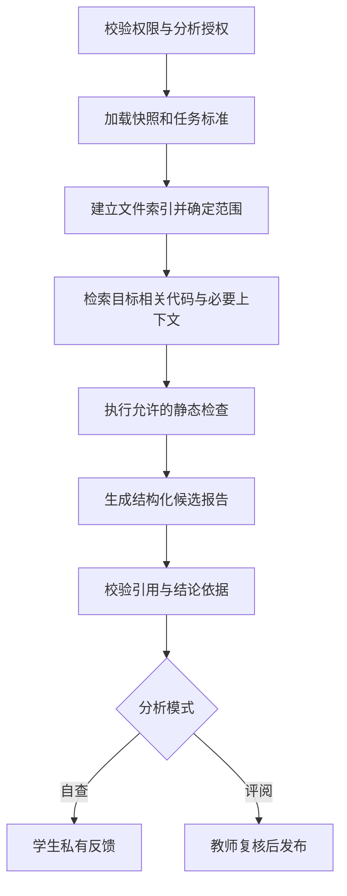

# 知因 CodeLab：任务化 AI 分析与版本提交落地方案

> 版本：V1.0｜日期：2026-10-18（Asia/Shanghai）  
> 用途：产品评审、技术设计、开发拆解、测试验收与汇报说明。  
> 状态：本方案已进入工程实现；当前完成范围、验证证据和剩余验收见[实施记录](../engineering/COURSEWORK_IMPLEMENTATION_2026-10-18.md)。本文后续只读核对和未实施描述保留为制定方案时的历史背景，不代表当前状态；推荐设计不等于已获逐项确认。  
> 文件格式：Markdown，便于在仓库、Obsidian 和编辑器中阅读、修改、版本对比。本文是本次增量方案的单一主文档，不替换历史实施与验收记录。

## 阅读导航

- 产品与教学讨论：第 1—8 节。
- 数据、接口与开发设计：第 9—13 节。
- 排期、验收与演示：第 14—18 节。
- 尚需确定的默认规则：第 19 节。

## 1. 一页决策摘要

### 1.1 产品定位

Code Lab 是面向课程任务的 AI 代码／项目分析与教学辅导工具。教师发布课程目标与材料，学生使用自己熟悉的 IDE 开发，以代码片段、文件、压缩包或 Git 仓库版本提交成果；Agent 围绕任务要求分析，教师确认正式评价。

平台不建设在线 IDE，不自建 GitHub，不接管团队日常分支与合并。平台提供只读代码浏览、版本差异、证据定位及提交管理，这些服务于分析和评价。

### 1.2 本次升级解决的三个原始问题

| 评委反馈 | 产品回答 | 可验收结果 |
| --- | --- | --- |
| 小目标不该必须上传完整项目 | 统一支持片段、文件、ZIP、仓库，并指定分析范围 | 一个函数可以直接提交并获得针对任务的反馈 |
| 第一次与第二次作业不能混在一起 | 每个子任务独立保存提交、报告和评价 | 切换任务不串代码、不串报告、不串评价 |
| 大作业内的小作业需要分别提交 | 作业容器下设置子任务，支持独立及连续开发 | 每个子任务分别交作业，大作业汇总进度 |

### 1.3 设计结论

1. 用“课程／班级 → 作业 → 子任务”组织教学；实际提交绑定子任务。
2. 用固定代码快照组织分析，Git 提交与正式交作业分开。
3. 学生自查与教师评阅分开，教师不读取自查过程。
4. Gitee 优先，GitHub 同属目标交付范围，公开与私有仓库均支持。
5. 学生自查先解释和提示，再按请求提供辅助代码；教师可禁用辅助代码。
6. 新增通用输入推荐先采用静态分析；保留已有受控执行路径，不自动执行任意新仓库。
7. 分阶段交付，但最终验收必须覆盖个人／团队、独立／连续和两种代码托管平台。

## 2. 需求基线与范围

### 2.1 已确认需求

| 编号 | 需求 | 必须保持的边界 |
| --- | --- | --- |
| R01 | 聚焦 AI 分析与教学辅导 | 不建设在线开发网站 |
| R02 | 支持小练习、大作业及子任务 | 简单练习不强迫教师操作复杂层级 |
| R03 | 独立与连续任务混合 | 连续任务继承明确版本，不自动覆盖前后任务 |
| R04 | 自由选择 IDE | 不要求安装专有开发工具 |
| R05 | 片段、文件、ZIP、GitHub、Gitee | Gitee 优先，私有仓库可用 |
| R06 | 提交固定代码版本 | 报告和评价独立绑定该版本 |
| R07 | 前置任务提交成功即可继续 | 不等待 AI 或教师通过 |
| R08 | 团队作业及个人贡献分析 | 依据证据，不用代码行数直接评分 |
| R09 | 提交前分层辅导 | 教师可按子任务关闭辅助代码 |
| R10 | 提交后 AI 辅助与教师评价 | 最终评价由教师确认 |
| R11 | 教师只见正式提交及报告 | 不展示或暗中使用学生自查对话 |
| R12 | 截止前多次提交 | 以最后一次成功提交为准 |
| R13 | 指定对象限时补交 | 最后一次成功补交为准，保留补交标记 |
| R14 | 私有代码可交外部模型分析 | 明确告知并获得相应授权 |

### 2.2 推荐、但未逐项确认的设计

- 通用输入首版以静态分析为主；不是用户已经确认放弃运行验证。
- 同一作业选择个人或团队模式，子任务继承；首版不支持同一作业中切换提交主体类型。
- 连续任务首版只设一个前置任务，允许分叉，不支持多个前置任务自动合并代码。
- 补交期限内可多次提交；服务端成功提交时刻严格早于截止时刻才有效。
- 教师手动发起付费 AI 评阅；未配置模型不阻断提交和人工评价。
- 团队由指定提交人提交，普通成员查看成果、维护自己的贡献说明。
- 新任务默认仅提交主体与授课教师可读正式代码，不自动沿用历史班内共享设置。

以上推荐在开发前集中确认；本文后续按这些默认值形成可执行设计，避免用模糊选项代替方案。

### 2.3 本轮不建设

在线编辑器、终端、云开发容器、Git 托管与合并界面、自动代写后推送仓库、任意代码在线执行、自动最终打分、抄袭裁决、复杂课程总评权重、学校全部教务功能。现有互评和作品展示保留其既有边界，不扩展为本轮重点。

## 3. 与现有项目的衔接

### 3.1 本次只读核对范围

查阅了根 README、模型配置说明、历史教学闭环方案、项目地图说明，并抽查 `project-course.ts`、`source-projects.ts` 及相关模块目录。本次没有启动服务、执行迁移、运行测试或调用真实模型；以下“已有基础”是文档与代码层面的观察，不是当前端到端验收结论。

| 已有基础 | 本次复用方向 | 不应作出的推断 |
| --- | --- | --- |
| Vue 3 前端、Fastify API、PostgreSQL、后台 worker | 沿用现有架构，按模块增量扩展 | 不需要重建另一套产品 |
| 普通项目 ZIP 分析与代码证据阅读 | 统一来源入口、任务范围和代码快照 | 不代表片段与 Git 已经支持 |
| 项目任务、提交版本、教师评价 | 增加作业容器、子任务与提交主体 | 不代表目前已实现嵌套作业和团队授权 |
| 受控 Vue 模板执行及报告链路 | 保留为特定任务的可选证据来源 | 不代表任意仓库可以安全执行 |
| 个人模型配置、配置版本与用量记录 | 自查由学生发起，评阅由教师发起 | 不默认改成平台共享密钥或统一付费 |
| 部分课程共享／互评能力 | 迁移时明确旧权限，新任务单独配置 | 不默认把私有仓库内容共享给全班 |

### 3.2 需要优先消解的现有冲突

1. 当前项目提交链路可能关联已有项目导读；新增正式评阅不能借此暴露私人自查会话。将“同一代码”与“同一报告可见性”分开。
2. 当前存在迟交标识基础；新规则要求截止后无授权即拒绝提交，不能只打一个迟交标签。
3. 历史按个人用户取最新提交的查询，需要扩展为按“子任务＋个人或团队主体”取最新有效提交。
4. 现有共享规则必须逐接口核对，尤其源码读取、报告下载、导出、互评入口，不能仅隐藏页面按钮。
5. 原始代码可能通过报告附件、模型日志、缓存或导出泄漏；自查隔离须覆盖所有派生数据。

## 4. 核心概念与任务组织

| 概念 | 定义 |
| --- | --- |
| 作业 Assignment | 一个教学主题或大作业的容器，拥有发布对象、完成进度和个人／团队模式 |
| 子任务 Task | 实际布置、提交与评阅的最小教学单位 |
| 提交主体 Subject | 个人学生或课程内团队，和执行提交操作的人分开 |
| 来源 Source | 粘贴代码、上传材料或关联仓库的入口信息 |
| 快照 Snapshot | 已获取并验证的不可变代码内容与清单 |
| 自查 Self-check | 私人的学习分析过程，不是正式作业 |
| 正式提交 Submission | 将固定快照交给指定子任务的业务记录 |
| 分析 Analysis | 针对快照、任务标准和分析模式生成的结果 |
| 评价 Evaluation | 教师对某次正式提交确认并发布的结果 |

简单练习内部仍有一个子任务，界面省略无意义的中间页面。一个大作业可混合独立与连续子任务。子任务依赖必须属于同一作业且无环。

```text
Web 开发课程 / 2026 秋季班
└─ 大作业：学生管理页面（团队模式）
   ├─ T1 列表展示：独立开始
   ├─ T2 姓名搜索：继承 T1 的某次成功提交
   ├─ T3 新增学生：继承 T2 的某次成功提交
   └─ T4 数组去重：独立的小函数练习
```

任务配置至少包含：标题、目标、说明、起始材料、评价标准、允许来源类型、分析范围、截止时间、前置任务、辅助代码开关。团队模式下再配置负责人及参与人。

任务发布后，描述性勘误可更新并保留记录；实质性目标、量表或辅导政策变化生成新修订版本。建议已有提交仍按原快照评阅，教师如要求按新规则重新提交，应明确通知，不能静默重算历史评价。

## 5. 完整业务流程

### 5.1 教师创建与发布

1. 选择已有课程／班级，创建普通练习或多任务作业。
2. 选择个人／团队模式；团队通过平台邀请并由成员确认加入，不仅录入姓名。
3. 定义子任务目标、完成标准和截止时间。
4. 提供起始片段、附件或固定仓库版本；起始材料版本与任务修订一起保存。
5. 设置独立或连续任务关系，设置辅助代码政策。
6. 预览学生视图并发布，得到平台任务链接。

平台链接用于任务入口与权限校验；Git 仓库链接用于获取代码，两者同时存在。拿到任务链接不等于自动获得私有代码访问权。

### 5.2 学生独立练习

打开任务 → 获取材料 → 在任意 IDE 编写 → 选择代码并自查 → 按提示修改 → 准备代码快照 → 确认正式提交 → 查看提交回执 → 等待教师发布评价。

上传与自查都不自动交作业。即使模型不可用，学生仍可正常准备快照并正式提交。

### 5.3 连续开发

前置任务有成功提交后解锁下一任务。首次进入建议默认选用前置任务当时的最新有效提交，并保存 `base_submission_id`；学生确认后固定。

- 平台不创建云工作区，而是提供基线下载或仓库提交定位。
- 学生可在同一仓库继续开发，也可下载后本地修改，平台只记录继承来源。
- 前置任务后来更新，不自动更新后续任务基线或代码。
- 首次正式提交前可显式重选基线；已正式提交的版本不改写，后续版本重新记录基线。
- 基线来源记录不能证明学生实际沿用代码；需要时比较内容并标明差异，不伪造继承证据。
- 前置任务补交成功同样满足解锁条件，但不会自动延长后续任务截止时间。

### 5.4 正式提交与评阅

1. 学生先准备输入，等待快照进入 `ready`。
2. 页面展示任务、主体、文件范围、来源版本及截止时间，学生点击正式提交。
3. 服务端事务校验权限、前置条件、截止或补交授权，并生成回执。
4. 教师进入最新有效提交队列，查看代码与基础信息。
5. 教师可主动发起 AI 辅助评阅，查看候选报告，确认评价并发布。
6. 学生再次提交时，旧评价留在旧版本，新版本独立待评阅。

建议正式 AI 候选报告由教师预览，发布后学生才看到正式反馈；学生自己的自查报告仍即时可见。自动触发付费评阅不作为默认行为。

### 5.5 时间和补交规则

所有时间使用服务端时间，数据库存 UTC，界面按课程时区展示；首期显示北京时间。

- 正常窗口为 `accepted_at < due_at`，等于截止时刻即关闭。
- 上传开始、仓库导入开始、浏览器点击时间不能作为成功提交时刻。
- 导入完成后仍需在有效窗口内正式提交；页面提前提示网络准备时间。
- 补交授权绑定子任务与主体，保存开放时间、截止时间、授权教师及原因。
- 补交窗口内允许多次提交，均保留补交标记；最后一次成功补交成为评阅对象。
- 撤销补交授权阻止未来提交，不抹除已成功补交。
- 导入／提交失败不替换旧有效版本；分析失败不撤销已成功提交。

例：20:00 截止，19:59 开始导入，20:01 才完成，不算按时提交；教师可按规则开放补交。该严格边界须在页面明示。

## 6. 输入来源、Git 和固定版本

### 6.1 统一输入契约

| 来源 | 必填信息 | 快照形成方式 | 特别说明 |
| --- | --- | --- | --- |
| 片段 | 文件名、语言、代码 | 生成带规范路径的虚拟文件 | 一次性输入框不是在线 IDE |
| 文件／多文件 | 文件及相对路径 | 校验后保存清单与哈希 | 保留必要目录结构 |
| ZIP | 压缩文件 | 安全解压、筛选、生成清单 | 不自动执行安装脚本 |
| GitHub／Gitee | 仓库身份、具体提交、读取授权 | 固定提交后获取文件与历史 | 分支名只帮助选择，不作为版本身份 |

所有入口转换成统一的快照清单：规范路径、文件大小、内容哈希、语言、来源、获取时间、排除项及原因。分析器消费快照，不针对可变的远程分支直接分析。

### 6.2 分析范围

允许老师设定或学生提出目录、文件、符号范围；教师要求的必需文件不能被学生自行排除。Git 仓库范围示例：`src/features/search/`。

分析时允许在预算内读取必要上下文，例如类型定义和被调用函数，并在报告列出实际读取范围。缺失上下文则说明“无法判断”，不强行索取完整大项目，也不宣称局部代码代表全项目正确。

### 6.3 双平台适配

建议统一 `GitProviderAdapter`：验证授权、读取仓库元数据、列分支、解析提交、获取文件、读取提交历史和比较版本。提供商差异封装在 Gitee、GitHub 实现内。

正式实现前必须核实两平台当时的官方接口、授权范围、配额及私有仓库能力。本方案不宣称某个 OAuth scope 或归档 API 已验证可用。优先 OAuth（授权登录）；如受部署条件限制采用访问令牌，只接受最小可用权限，前端不回显完整凭据。

建议首版按需读取，不依赖 webhook。代码推送不自动交作业，也不自动触发付费模型。首期不自动递归获取子模块和 Git LFS 大文件，应提示缺失并允许另行上传必要材料。

### 6.4 国内网络与恢复

Gitee 入口优先展示，但不承诺其永远可达。区分授权失效、仓库不存在／无权限、限流、网络超时、文件超限；记录操作 ID，允许查询和重试。

导入重试始终使用最初解析出的提交标识，不跟随新分支头。若网络失败可转文件／ZIP 提交，但不得自动伪造原 Git 来源或贡献历史。已有快照不因远程删除、强推或授权撤销而被静默替换。

## 7. AI 自查与教师评阅

### 7.1 同一标准，不同可见性

分析输入包括：固定代码快照、任务修订、评价标准、分析范围、必要证据、模式和模型配置版本。自查与评阅遵循同一任务目标；教师隐藏测试或内部评分材料不传入学生自查上下文。

| 项目 | 自查 | 正式评阅 |
| --- | --- | --- |
| 目标 | 促进学生理解和修改 | 帮教师评价正式成果 |
| 发起者／建议计费人 | 学生本人 | 发起评阅的教师 |
| 数据权限 | 会话本人 | 授课教师；发布后的授权提交主体 |
| 输出 | 问题、解释、提示、按政策允许的代码 | 目标达成、证据、风险、验证限制、贡献材料 |
| 影响正式成绩 | 不直接影响 | 教师确认后才形成评价 |

同一快照可复用确定性的文件索引或基础检查，但不能把私人自查文本作为正式评阅输入。跨模式报告默认分别生成；任何缓存复用都必须匹配任务版本、模型配置、可见性及权限。

### 7.2 分层辅导

L1：问题位置、原因、与要求的差距。  
L2：知识点、分步思路、验证办法或适度伪代码。  
L3：学生主动请求后提供针对卡点的辅助代码，并解释适用条件。

默认先 L1，再由学生请求 L2／L3；可邀请学生附上尝试，但不通过失败次数推断能力，不假装能判定“确实不会”。重新上传代码后，新一轮分析绑定新快照，历史会话仍对应旧代码。

关闭辅助代码时，服务端限制工具与输出模式，模型指令和结果校验共同防止用完整伪代码变相交答案。政策变化按最新教师限制执行后续请求，但不可能收回学生此前已看过的代码。平台限制不等于能约束学生使用其他 AI 工具。

### 7.3 Agent 工作流



建议工具：读取清单、读取片段、查找符号、读取差异、读取授权历史、获取任务标准。工具读取必须绑定快照及主体；Agent 不能传任意文件路径或仓库 URL 越权读取。

不授予任意终端、推送、删除或无约束联网工具。代码中的 README、注释和字符串视为分析材料，不作为更改系统指令的依据。运行步数、读取字节、Token 和耗时均有预算，达到上限输出“分析不完整”及已完成范围。

### 7.4 报告格式

报告页首显示：任务名、提交版本、来源、分析模式、覆盖范围、是否运行过测试。

每个目标条目包含：`requirementId`、判断（符合／部分符合／不符合／无法判断）、文件行号、证据说明、影响、建议、验证方式。不存在的文件或越界行号不得成为引用。

教师默认查看简明摘要：完成情况、主要问题、验证限制；展开后看源码与贡献证据。不把自查次数、提示请求或“使用 AI 程度”作为隐藏评分指标。

静态分析只能给静态证据，不能写“运行通过”。若有既有受控执行证据，应明确测试范围、环境、时间和结果，不能把某一个案例通过扩展为全项目通过。

### 7.5 费用与降级

沿用现有个人模型配置：学生自查使用学生配置，教师主动 AI 评阅使用教师配置。保存任务、导入代码、正式提交、人工评价不强制依赖模型。

团队自查建议仍属于发起成员个人，不自动向其他成员开放。团队源码权限与个人会话权限分离。后续如要共享会话必须另行设计。

界面显示发起人、所选模型、预算与实际返回用量；没有价格依据不虚构费用。模型失败保留提交和已知用量，不自动无限重试付费请求，不偷偷改用别人的密钥。

## 8. 团队协作与贡献证据

### 8.1 团队权限

团队归属于课程／班级，成员加入须确认。推荐由教师或团队负责人指定提交人；提交记录同时保存 `subject_id` 和 `submitted_by`，避免把上传人当成作者。

保存提交时的成员和分工快照。成员变更不追溯改写旧贡献材料；离队后停止读取新资料，历史访问与留存按课程政策处理。教师操作需要限定自己教授的班级。

### 8.2 贡献分析方法

1. 关联平台成员与 Git 身份，优先验证托管平台账户；仅凭同名不自动认领提交。
2. 确定分析区间：连续任务使用前置基线到本次提交；独立任务使用教师模板基线或显式选择的起点。
3. 排除模板历史、依赖目录、生成文件；合并提交和 squash 情况单独说明。
4. 分成员整理改动模块、相关目标、测试／文档及可追溯提交。
5. 合并任务分工与成员声明，分别标记“仓库证据”“本人说明”“教师确认”。

不把提交数、行数或 AI 推测转换为精确贡献百分比。Git 作者字段可被修改，提交历史也不能证明全部实际劳动。设计、测试、讨论、结对开发通过说明补充。

若基线不是祖先、历史缺失或只收到 ZIP，可做成果分析，但贡献结论标记证据不足。展示可验证的有限事实，不能把无法关联的提交算作“零贡献”。

## 9. 页面与交互设计

### 9.1 页面信息结构

| 页面 | 关键内容 | 主要操作 |
| --- | --- | --- |
| 作业列表 | 课程、截止、子任务进度、本人待办 | 进入作业 |
| 作业详情 | 子任务顺序、独立／连续关系、团队信息 | 进入子任务、获取材料 |
| 子任务详情 | 目标、标准、截止、辅导规则、当前提交 | 导入、自查、正式提交 |
| 来源选择 | 片段／文件／ZIP／仓库 | 准备快照、查询导入进度 |
| 自查详情 | 私人对话、问题引用、进一步提示 | 提交修改后的代码、请求帮助 |
| 提交历史 | 版本、时间、补交标记、报告与评价 | 只读查看、比较两个版本 |
| 教师评阅队列 | 每主体最新提交、分析状态、待评价 | 发起 AI、进入评阅 |
| 教师评阅详情 | 摘要、证据、贡献材料、教师意见 | 保存草稿、确认发布 |
| 补交管理 | 指定子任务、主体、时间、原因 | 开放或撤销补交 |
| 仓库连接 | 平台、授权状态、可读仓库 | 授权、重新授权、断开 |

### 9.2 防止作业混淆

所有提交与报告页持续显示“课程 / 作业 / 子任务 / 个人或团队 / 版本”。页面状态和缓存键必须包含这些业务身份。切换任务清空未确认的来源选择，或明确提示保留在原任务草稿中，不静默搬运。

正式提交前确认卡示例：

```text
提交到：学生管理页面 / T2 姓名搜索
提交主体：第 3 组    操作人：小王
来源：Gitee / team/student-app / 提交 8f3…
范围：src/search.ts、src/types.ts
材料状态：已保存    分析状态：尚未分析
提交窗口：补交，截止 10 月 22 日 20:00
[确认正式提交]
```

哈希缩写仅用于显示，后台保存完整标识。提交成功回执包含提交号和服务端时间，不能只显示模糊的“上传完成”。

### 9.3 必须具备的异常状态

无前置提交、未加入团队、仓库无权限、授权过期、网络失败、导入超限、截止已过、补交已撤销、模型未配置、模型失败、静态分析不完整、教师尚未发布、代码引用缺失。每种状态说明原因、已保留的数据和可执行下一步。

## 10. 数据模型与不变量

下列是逻辑模型，不是要求直接新建所有同名表。实施时映射到现有 `tasks`、`project_submissions`、`source_projects` 等结构，避免重复保存同一业务事实。

| 实体 | 关键字段与约束 |
| --- | --- |
| assignments | class_id、title、subject_mode、status |
| tasks / task_revisions | assignment_id、目标与量表、due_at、help_policy、scope；修订不可变 |
| task_dependencies | task_id、predecessor_task_id；同作业、无环、首期至多一个前置 |
| subjects / team_memberships | 个人或团队身份、成员有效期、角色 |
| repository_connections | provider、owner、repository_id、凭据引用、授权状态 |
| imports | source_type、resolved_commit、status、failure_code、actor_id |
| code_snapshots | owner_scope、manifest、content_hash、source_metadata、storage_ref |
| submissions | task_id、subject_id、sequence、snapshot_id、task_revision_id、base_submission_id、accepted_at、late_grant_id、submitted_by |
| late_grants | task_id、subject_id、opens_at、closes_at、granted_by、revoked_at |
| self_check_sessions | owner_user_id、task_id、snapshot_id、messages_ref、help_policy_version |
| analyses | snapshot_id、submission_id 可空、mode、policy/model版本、status、report_ref、billing_user_id |
| evaluations | submission_id、teacher_id、revision、draft/published、feedback、可选分数 |
| contribution_evidence | submission_id、member_snapshot、baseline、证据与声明的类型 |
| consent_records / audit_events | 授权主体、用途、接收方、版本、撤销及关键操作 |

### 10.1 必须实现的不变量

1. `UNIQUE(task_id, subject_id, sequence)`；版本序号由服务端事务分配。
2. 已成功提交的快照、任务修订和基线不能原地替换。
3. 最新有效提交按成功接受的序号选择，不按 AI 报告完成时间选择。
4. 正式报告的快照必须与提交一致；评价必须绑定提交 ID。
5. 补交记录只能用于授权的子任务和主体，且接受时间处于授权窗口。
6. 自查会话不能通过教师角色、团队角色或班级共享间接读取。
7. 分析失败、取消或重试不改变提交是否成功。
8. 发布评价后更正创建新评价修订，保留原发布历史。
9. 对象文件的读取同样经过业务授权，不能只靠知道对象 ID 或文件 URL。

### 10.2 正式提交事务

```text
BEGIN
  校验幂等键；同键不同内容拒绝
  锁定 task + subject 的提交序列／聚合记录
  校验当前成员、提交角色、前置提交及快照归属
  使用服务端时间核对正常窗口或有效补交授权
  校验快照 ready 且持久化可读
  分配 sequence 并保存提交、任务修订、成员快照
  更新最新有效提交指针并保存幂等回执
COMMIT
```

如自动排入基础分析队列，应使用同事务 outbox（事务消息记录）后投递，避免提交已保存但任务丢失。外部 Git 网络请求和模型请求不放进数据库事务。

## 11. 状态机和接口草案

### 11.1 分离状态

| 对象 | 状态 |
| --- | --- |
| 导入 | created → fetching → validating → ready；或 failed/cancelled |
| 提交 | accepted；正常／补交为附加属性，是否最新是派生关系 |
| 分析 | queued → running → succeeded/failed/cancelled |
| 评价 | draft → published；更正创建新修订 |
| 提交窗口 | 正常开放／已截止／指定补交开放／关闭，由时间与授权计算 |

不要用一个 `status` 同时表达“作业已交、模型失败、教师未评”，否则页面和统计容易互相覆盖。

### 11.2 API 建议

以下路径为草案，实施前遵循现有路由命名和版本约定。

| 方法与路径 | 用途 |
| --- | --- |
| POST /api/assignments | 创建作业 |
| POST /api/assignments/:id/tasks | 创建子任务 |
| POST /api/tasks/:id/revisions | 更新任务要求并留修订 |
| POST /api/repository-connections | 建立仓库连接／授权 |
| POST /api/imports | 准备任一来源的快照 |
| GET /api/imports/:id | 查询导入状态和固定版本 |
| POST /api/tasks/:id/self-checks | 创建私人自查 |
| POST /api/self-checks/:id/messages | 请求进一步提示或辅助代码 |
| POST /api/tasks/:id/submissions | 正式提交 ready 快照，要求幂等键 |
| GET /api/tasks/:id/submissions | 按主体与权限列版本 |
| POST /api/submissions/:id/analyses | 教师主动发起正式 AI 分析 |
| POST /api/submissions/:id/evaluations | 保存教师评价草稿 |
| POST /api/evaluations/:id/publish | 确认发布 |
| POST /api/tasks/:id/late-grants | 开放指定补交 |
| POST /api/late-grants/:id/revoke | 撤销未来补交权限 |
| GET /api/submissions/:id/diff?base=… | 比较两个均有读取权的固定版本 |

提交请求示例：

```json
{
  "subjectId": "team_3",
  "snapshotId": "snapshot_ready_42",
  "taskRevisionId": "task_revision_2",
  "baseSubmissionId": "submission_t1_v2",
  "note": "补齐空关键词处理"
}
```

ID 为示意，不改变现有 UUID 约定。客户端不能指定服务端接受时间、最终版本号或自行声明补交有效。错误码建议包括 `SUBMISSION_CLOSED`、`SOURCE_NOT_READY`、`PREREQUISITE_MISSING`、`TASK_REVISION_CHANGED`、`REPOSITORY_AUTH_REQUIRED`、`IDEMPOTENCY_CONFLICT`。

## 12. 权限、私有代码与数据留存

### 12.1 权限矩阵

| 操作 | 本人／团队授权成员 | 其他学生 | 授课教师 |
| --- | --- | --- | --- |
| 查看任务要求 | 是 | 同班发布范围内 | 是 |
| 读取正式代码 | 提交主体授权范围内 | 默认否 | 本班任务内 |
| 查看个人自查内容 | 仅会话本人 | 否 | 否 |
| 正式提交 | 本人或指定团队提交人 | 否 | 不代替学生提交 |
| 看未发布正式 AI 候选 | 默认否 | 否 | 是 |
| 看已发布评价 | 对应提交主体 | 默认否 | 是 |
| 开放补交／发布评价 | 否 | 否 | 本班任务内 |

自查隔离须落实到 API、搜索、导出、下载和日志，不只是教师界面隐藏。管理员运维只保留最小必要元数据访问，不通过普通管理页面批量阅读私人对话。

### 12.2 私有仓库与外部模型授权

仓库读取、向模型发送代码、向教师正式提交、班内展示是不同目的，不能合并成一个隐含同意。

授权界面说明接收方／模型服务、用途、可能发送的文件范围和撤销影响；模型提供方发生实质变化时重新确认。组织仓库由有权限的负责人授权；技术上能读取不自动证明可以对外发送。

凭据加密存放，密钥与数据库分离保管；模型输入、报告、日志不包含访问令牌。默认排除 `.env`、私钥、依赖目录、构建产物与二进制，发现疑似秘密时阻止相关文件外发并提示处理。

不承诺检测能发现全部秘密，也不承诺撤销授权能让外部服务收回已发送数据。撤销停止未来读取或外发；已正式提交材料的保留期限应在提交前告知。

### 12.3 不可信材料处理

仓库域名限制为支持的托管平台；验证重定向和下载地址，阻止访问内网元数据服务等 SSRF 风险。上传限制压缩前后大小、文件数、嵌套层数，拒绝路径穿越、越界符号链接和压缩炸弹。不执行 Git hooks、安装脚本或学生代码。

存储引用由服务端生成；删除按归属执行，保留审计。迁移沿用并扩展现有留存机制，不另起绕过权限的清理脚本。

建议留存参数化：未提交导入和私人自查较短、正式成果按课程周期保存；具体天数、撤回处理与备份清除窗口列为上线前确认项，不在本文虚构学校政策。

## 13. 工程落地与迁移

### 13.1 模块分工

| 现有位置 | 建议职责 |
| --- | --- |
| apps/web/src | 作业与子任务视图、来源选择、私人自查、教师队列、版本对比 |
| apps/api/src/project-course.ts | 项目教学业务入口；新增逻辑逐步拆为任务／提交／补交模块 |
| apps/api/src/source-* | 复用内容读取、ZIP、分析、预算和版本差异能力 |
| apps/api/src/user-model-settings.ts 等 | 复用个人模型配置与计费人绑定 |
| apps/api/src/worker-v2.ts 等 | 按现有队列实现导入、静态分析、失败恢复 |
| packages/contracts | 任务、来源、快照、提交、报告的共享校验契约 |
| apps/api/src/migrations.ts 等 | 增量 SQL 迁移，实际结构以迁移为准 |
| apps/runner | 保留受控执行，不默认接收通用仓库 |
| tests | 事务、权限、适配器、Agent 质量及师生端到端回归 |

不预设换框架或新增微服务。先复用现有后台队列与存储；只有实测导入负载与模型任务互相阻塞时，再拆 worker 队列和并发池。

### 13.2 迁移步骤

1. 在隔离副本核对数据库、旧提交权限、分析可见性及现有课程 UI 的真实情况。
2. 增量加字段／表，先兼容旧读取；旧任务映射为只有一个子任务的作业。
3. 历史个人提交建立个人主体映射，保留原 ID、序号、代码及评价关联。
4. 历史迟交保留为“历史迟交”，不追溯伪造教师补交授权，不突然删除原有效提交。
5. 无法证明不可变的历史代码／报告标记“历史快照信息不完整”，不能补造 SHA 或证据。
6. 历史班内共享记录保留原状态，新任务采用新默认值；改变旧访问范围需明确迁移规则。
7. 按任务开启新流程，先内部样本，再一门课小范围试点，再扩大。
8. 新数据写入后回退使用功能开关隐藏入口、保留新数据；不通过破坏性降级删除新表。

### 13.3 可观测性与容量

关联导入 ID、快照 ID、提交 ID、分析 ID；日志保留状态与耗时，不记录完整代码和密钥。监控仓库成功率、鉴权失败率、排队时长、分析失败类型、已知模型用量及存储增长。

建议试点工程目标（非已有测量结果）：普通列表 API 的 p95 小于 1 秒；ready 快照正式提交 p95 小于 2 秒，均不含文件导入与模型耗时。以约定并发数、数据量和部署环境重新测量。导入与 AI 显示真实阶段，不承诺固定秒数完成。

## 14. 分阶段实施计划

阶段是开发次序，不是删除已确认范围；只有全部目标范围验收后，才能宣称本方案完成。

| 阶段 | 主要工作 | 进入下一阶段的条件 | 粗估人日 |
| --- | --- | --- | --- |
| P0 基线与契约 | 核对旧数据、确认默认规则、Git 官方接口小验证、冻结契约 | 权限与迁移方案可评审，双平台读取可行性明确 | 3—5 |
| P1 任务与提交骨架 | 作业／子任务、主体、依赖、快照、截止、补交、最新版本 | 不依赖模型也能完成个人／团队提交和教师评价 | 8—12 |
| P2 多来源与仓库 | 片段／文件复用 ZIP；Gitee 后 GitHub；公私仓库 | 来源统一成快照，固定版本、网络恢复和授权通过 | 7—11 |
| P3 教学 Agent | 任务范围、分层辅导、政策、正式评阅、私有隔离与计费 | 自查不泄漏、报告可追溯、模型失败不阻断作业 | 7—11 |
| P4 贡献与体验 | Git 区间贡献、分工说明、版本差异、教师摘要 | 不伪造贡献，团队与任务切换不串数据 | 5—8 |
| P5 回归与试点 | 迁移恢复、故障演练、真实模型评测、师生试用 | 验收矩阵通过，未覆盖项明确披露 | 5—8 |

合计约 35—55 人日，是初步工程工作量，不是固定工期或承诺。假设复用现有登录、课程、上传、存储与模型能力；实际以 P0 结果修订。两人可按前后端并行，但联调与试点不能简单除以二估算。

若答辩时间紧，先演示完整的单条 Gitee 小任务闭环并明确阶段状态，不用模拟数据声称 GitHub 私有仓库或团队贡献已经完成。

## 15. 验收矩阵

下列为待执行测试，不代表本次已通过。每项应保存环境、步骤、预期、实际、证据路径与结论。

| 编号 | 场景与操作 | 通过标准 | 需求 |
| --- | --- | --- | --- |
| A01 | 创建只有一个子任务的练习，提交一个函数 | 无需 ZIP；报告只围绕目标与必要上下文 | R01 R02 R05 |
| A02 | 大作业下交 T1、T2，来回切换 | 代码、报告、评价、缓存均不串任务 | R02 R06 |
| A03 | T1 成功后 AI 仍排队，进入 T2 | 可继续；基线固定到 T1 的具体提交 | R03 R07 |
| A04 | T1 再提交新版本 | T2 已选基线和已交代码保持原样 | R03 |
| A05 | Git 选择提交后远程分支继续推进／强推 | 平台仍读取原提交；失败不改为新分支头 | R05 R06 |
| A06 | Gitee／GitHub 各测公开及私有仓库 | 四种组合完成获取、提交、分析；真实授权证据 | R05 R14 |
| A07 | IDE 本地改代码后上传或推送 | 无专有 IDE 依赖，不要求平台编辑器 | R04 |
| A08 | 同时重复点击提交、响应丢失后重试 | 相同幂等键只生成一个版本，可查回执 | R06 R12 |
| A09 | 截止前后及精确截止时刻提交 | 边界符合规则，不采信客户端时间 | R12 |
| A10 | 给团队 A 开补交，团队 B 尝试 | 仅 A 可交；标记补交且最新版成为评阅对象 | R13 |
| A11 | AI 超时／额度不足／无密钥 | 已交代码保持有效，教师可人工评价 | R10 R12 |
| A12 | 教师改 URL 访问学生自查和导出 | 服务端拒绝；正式报告不含私人过程 | R11 |
| A13 | 关闭辅助代码后请求完整答案 | 各入口遵守政策，无变相完整答案 | R09 |
| A14 | 开启辅助代码，先提示后主动求助 | 分层反馈可用，代码建议绑定当前版本 | R09 |
| A15 | 团队上传人不是代码作者 | 分开显示提交操作人和贡献证据 | R08 |
| A16 | 同名作者、squash、历史缺失、ZIP | 不误认身份；证据不足时不生成虚假比例 | R08 |
| A17 | 发布旧版评价后学生再交新版 | 旧评价留旧版，新版待评，不自动沿用 | R06 R10 |
| A18 | 导入失败或模型失败后重试 | 不覆盖此前有效提交，不产生无界付费重试 | R05 R12 |
| A19 | 恶意 ZIP、内网 URL、秘密文件、提示注入 | 导入／外发边界生效，Agent 不越权 | R05 R14 |
| A20 | 无运行证据的静态报告 | 明示未运行，不宣称测试通过 | R10 |
| A21 | 新旧任务共存、历史共享及报告读取 | 老数据可读，权限不被意外扩大 | R06 R11 |
| A22 | 教师查看最新队列、补交、摘要和历史 | 默认最新有效版；证据按需展开 | R10 R12 R13 |

### 15.1 AI 质量评测

构造有正确实现、常见错误、缺少上下文、跨文件依赖、恶意注释与辅导限制的样本。训练／调提示样本与最终评测样本分开，不能反复调同一批题后宣称泛化能力。

至少记录：目标覆盖率、有效引用率、问题误报与漏报、无依据运行结论、辅导越界、隐私泄漏、响应耗时、已知 Token 用量。引用可自动校验，教学合理性需教师抽评。

硬门槛：权限测试无已知泄漏；无虚构运行通过；引用必须可解析。模型质量阈值需试点评审制定，不把一次成功调用当作教学效果验收。

## 16. 风险与取舍

| 风险 | 处理方式 |
| --- | --- |
| 平台变成复杂在线 IDE | 仅输入／上传／只读浏览，不提供编辑运行工作台 |
| Git 平台接口和授权差异 | 先做适配验证，错误分类；保留上传路径 |
| GitHub 国内访问不稳定 | 固定版本、异步导入、重试、清晰失败回执 |
| 自查被误用于评价学生 | 独立权限和上下文，不生成使用 AI 程度评分 |
| 学生只上传局部却被评价全项目 | 报告显式列覆盖范围和缺失上下文 |
| Git 历史被当成真实劳动证明 | 区分证据、声明和教师确认，不机械算百分比 |
| 高频提交导致 AI 费用激增 | 正式提交不自动付费分析，教师按需触发 |
| 截止时间网络争议 | 准备快照与正式提交分离，明示服务端接受规则 |
| 私有仓库泄漏给全班 | 新任务默认最小可见范围，旧共享链路专项回归 |
| 历史代码与新数据模型不兼容 | 增量迁移、保留原 ID、隔离恢复演练 |

## 17. 汇报与演示方案

建议使用一门“Web 前端开发”课程、一个个人小练习、一个包含三项子任务的团队作业。演示仓库使用无敏感数据的授权样例。

1. 教师发布“补全搜索函数”，无需准备完整 ZIP。
2. 学生粘贴错误函数，自查先获得位置、原因和提示。
3. 学生主动请求更多帮助，展示辅助代码；再切换一个关闭辅助代码的任务说明差异。
4. 展示外部 IDE 开发后的 Gitee 固定提交，平台接收并显示回执。
5. 切换子任务，展示代码与提交历史隔离；前置成功后下一任务可开始。
6. 教师只看到正式报告与摘要，看不到学生自查对话。
7. 展示团队贡献证据及限制，教师确认评价。
8. 用明确标注的测试任务演示截止拒绝、指定补交和最新版本规则。

可向评委表述：

> 我们把分析单位从完整项目扩展到课程目标。老师可以布置一个函数，也可以把综合项目拆成连续或独立的小任务。学生仍用自己的开发工具，通过文件或 Gitee、GitHub 的固定版本交作业。平台在提交前提供分层辅导，在提交后为教师整理有代码依据的分析，版本、子任务和团队贡献各自可追溯。

不要宣称：自动证明学生独立完成、自动准确评分、任意项目安全运行、静态分析等于测试通过。

## 18. 开发任务清单与交付物

| 工作包 | 必须交付 |
| --- | --- |
| WP01 契约与迁移 | 数据关系、状态机、权限矩阵、迁移／恢复记录 |
| WP02 教学组织 | 作业、子任务、团队主体、依赖、任务修订 |
| WP03 快照与来源 | 统一清单、片段／文件／ZIP、Git 双平台适配 |
| WP04 提交一致性 | 幂等、截止、补交、最新有效提交、版本比较 |
| WP05 教学 Agent | 自查、分层帮助、正式评阅、结构化证据校验 |
| WP06 权限与计费 | 私人对话隔离、外发授权、凭据保护、个人用量 |
| WP07 团队贡献 | 身份映射、基线区间、证据／声明区分 |
| WP08 师生体验 | 页面流程、失败恢复、教师摘要、只读代码定位 |
| WP09 质量与试点 | 自动测试、真实 Git 授权、真实模型评测、师生走查 |

依赖关系：WP01 → WP02／WP03 → WP04 → WP05；WP06 贯穿所有工作包，WP07 依赖 Git 历史与团队主体，WP08 随接口逐步集成，WP09 每阶段执行而非最后才补。

## 19. 开发启动前待确认与待验证

不再重复询问已确认需求。以下可一次集中评审：

| 项目 | 本方案默认建议 | 性质 |
| --- | --- | --- |
| 通用代码运行 | 新入口先静态分析，保留现有受控执行 | 用户尚未明确确认 |
| 团队提交权限 | 指定提交人，成员共享正式成果 | 产品默认待确认 |
| 正式 AI 的发起与费用 | 教师主动发起，使用教师个人配置 | 延续现有模式，待确认 |
| 正式报告公开时机 | 教师发布后学生可见 | 产品默认待确认 |
| 新作业班内共享 | 默认关闭，展示另行授权 | 与旧共享模式衔接待确认 |
| 单前置与提交模式 | 首期一个前置，作业内统一个人／团队模式 | 范围默认待确认 |
| 截止精确边界 | 服务端接受时间严格早于截止 | 实施默认待确认 |
| 保存与撤回 | 按课程制定期限，私有自查独立留存 | 上线前政策待确认 |
| Git 授权方式 | OAuth 优先，最小可用读取权限 | 官方接口与部署条件待验证 |
| 性能与容量 | 沿用现有资源限制，再用试点数据调优 | 工程测量待完成 |

当前交付可用于评审和拆解开发；不能据此把尚未实施的能力写成产品现状，也不能以文档完成替代真实师生流程验收。

## 20. 本次参考与证据边界

主要依据为本次完整需求访谈。以下是只读检查的本地资料入口；历史记录中的成功仅属于其记载的时间与范围。

- [项目 README](../../README.md)：技术栈、运行入口、既有受控执行与模型计费边界。
- [模型配置说明](../MODEL_SETUP.md)：个人配置、配置快照、用量与失败处理。
- [教学闭环与体验升级方案 V2](CodeLab_教学闭环与体验升级方案_V2.md)：旧项目任务、版本、共享及教师反馈设计。
- [项目地图说明](../project-map-2026-09-30.md)：已有只读代码证据与项目分析阅读体验。
- [项目课程实现](../../apps/api/src/project-course.ts)：抽查任务、提交、权限和最新版本查询。
- [源码项目实现](../../apps/api/src/source-projects.ts)：源码项目相关模块入口。

本次未对 GitHub／Gitee 最新官方 API、授权权限、线上网络、真实模型质量或当前服务可用性作验证；相关事项已安排在 P0 和后续验收中。
