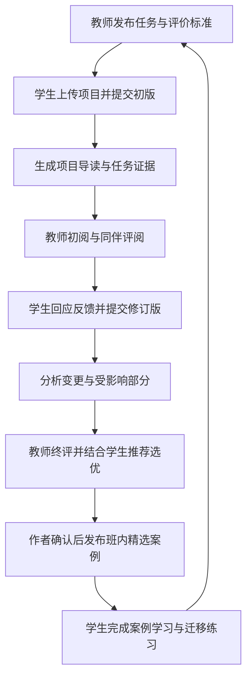
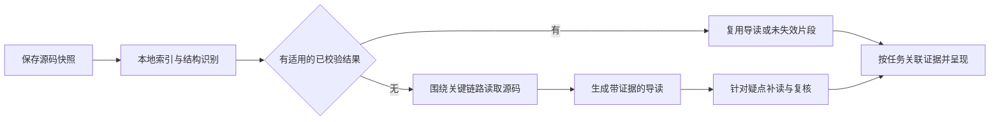

# 知因 CodeLab：教学闭环与低成本项目分析升级方案 V1

日期：2026-09-30。性质：下一阶段产品与实施建议，供团队评审；不代表新增功能已实现或教学效果已验证。

本方案综合本轮需求：把实训任务、AI 项目分析、师生共同评价和优秀案例学习串成闭环；同时降低发布、上传和评阅门槛，提高项目分析的普适性，在质量约束下控制成本，并延续现有设计语言重组前端体验。依据为当前代码、项目说明及实际学生端页面的只读观察。本轮交付为产品方案、页面交互规格与本地示例原型，正式业务功能按后文交付包实施。

用户已特别确认：**普通项目上传尽量少受模板和技术栈限制，这是本阶段的关键要求，也是 P0 首要验收项。** 新方案不能继续把固定 Vue 模板作为普通作业或个人项目分析的前置条件。

## 1. 判断与推荐方向

建议推进。这个方向给现有能力补上了连续的使用理由：教师通过任务组织教学，学生通过提交接受反馈，AI 帮双方理解项目，同伴评阅带来不同实现思路，优秀作品成为后续学习材料。

要把“按反馈再改一次”和“案例用于下次任务”加进来，才能形成学习闭环。只做到提交、投票和展示，仍难证明学生有所进步。

建议产品定位为：**帮助师生读懂真实项目、依据证据评价，并把每次实训沉淀为学习成果的项目学习平台。**

面向两类入口提供同一套分析能力：课程用户从任务进入，普通用户直接上传项目。普通项目分析继续独立可用；不要求所有用户先加入班级，也不让课程学生为同一份作业重复上传。

| 关键决策 | 推荐默认值 | 目的 |
| --- | --- | --- |
| 教学组织 | 以实训任务为课程用户主入口 | 增强任务存在感，让每次访问都有下一步 |
| 新建任务 | 默认开放项目任务；可选择带运行验收的模板任务 | 先覆盖不同课程，再按能力提供运行检查 |
| 提交方式 | 一个上传入口，绑定任务时自动创建提交版本 | 消除重复上传、重复填项 |
| AI 结果 | 同一提交版本生成可共享的项目导读，按角色呈现 | 减少重复推理和理解成本 |
| 同伴参与 | 默认每人评阅两个作品，给具体反馈并可推荐 | 提高覆盖公平性，保持操作简单 |
| 成绩与评优 | 教师确认成绩；同伴推荐参与优秀案例遴选 | 保留评价责任，避免人气影响分数 |
| 费用体验 | 保存和提交不触发模型费用；有已授权额度时无需个人 Key 即可分析 | 降低新用户进入门槛 |
| 展示范围 | 优秀案例先在本班展示，作者确认具体材料与版本 | 让教学分享可控 |

这些是建议默认值，并非用户已经确定的政策。具体课时、截止日期、预算和班级规模在实施时配置。

## 2. 当前基础与真正缺口

当前不是空白项目，已有任务、检查、复核和分析能力可以复用。应避免重建一套平行系统。

| 能力 | 当前已存在 | 本阶段需补充 |
| --- | --- | --- |
| 任务组织 | 教师建班、创建学生和任务、发布版本化验收规则 | 开放项目任务、轻量发布、教学截止时间、互评轮次 |
| 作业提交 | 学生向本人班级提交固定 Vue 模板 ZIP，保存历史版本 | 通用项目提交；关联已有项目；一次上传贯通任务与分析 |
| 运行证据 | 受控模板的真实检查、截图和日志 | 继续保留；扩充任务类型不自动扩大执行能力 |
| 教师反馈 | 逐项复核、确认、版本化发布、更正 | 批改队列、按量表组织证据、轻量评语与推荐 |
| 学生反馈 | 本人已发布反馈、复提比较 | 同伴评阅、反馈回应、修订说明 |
| 普通项目分析 | 通用 ZIP 静态分析、项目概览、模块、业务链路、阅读路线、源码引用、历史记录 | 任务上下文、角色化导读、质量评测及更有效的阅读策略 |
| 费用控制 | 单次预算、用量与预留、匹配成功报告复用、变更分析 | 课程内共享、分析分层复用、错误修正效率、统一额度体验 |
| 共享与沉淀 | 普通项目为所有者私有；课程反馈主要面向教师与提交者 | 按提交版本授权互评；优秀案例及下次任务引用 |

实际学生页面中，“AI 项目分析”排在导航前部，实训列表主要围绕规则、检查进度与已发布反馈展开。首页虽然已经是任务列表，但还缺少“我现在要完成什么”的教学活动组织，以及互评、评优和案例学习入口。仅调整导航顺序不足以解决存在感问题。

当前费用控制已经有实现。本阶段的成本优化建立在这些能力之上；本方案不把已有预算卡、成功报告复用或变更分析写成全新功能。

## 3. 完整使用闭环

所有活动围绕同一任务中的提交版本展开。AI 分析、教师意见、同伴反馈和评优结果都显示它们针对的是哪一版代码。

### 3.1 教师发布：一个页面即可完成

默认表单只突出四项：任务名称、任务要求、面向班级、提交截止时间。无班级时允许原页创建一个班级并生成加入码或加入链接；这是新增能力，现有教师创建学生的入口仍可保留。

粘贴已有作业要求后，可选择让 AI 提取评价标准；不调用 AI 也能使用内置通用量表。发布前在同一页展示标准、互评安排与可见范围，教师可以直接调整并发布，无需理解验收包、模型模式或运行器参数。

“更多设置”容纳附件、参考案例、互评开关、修订截止时间、迟交规则、评分维度和模板运行检查。默认开启互评时，系统根据提交截止时间生成建议评阅和修订时间，教师发布前可见并可改，不再要求逐项填写。

操作目标是“新教师首次使用可在 3 分钟左右发布一项普通任务”，需要新用户实测验证。若涉及建班、邀请学生，分别统计首次建班成本和单次发任务成本。

发布后的主要动作是“复制任务”和“查看待评”，后续复用任务比反复新建更重要。复制只复用要求、量表和经授权的参考案例，不复制学生提交或评价记录。

### 3.2 学生提交：一次上传，不重复交代项目

学生从任务详情进入，拖入 ZIP，系统识别项目名称、主要语言、候选入口和不需要分析的文件。学生只需确认材料并提交，可选补充一句实现说明。

上传、保存、提交和模型分析必须解耦：没有 API Key、额度不足或模型暂时失败，仍应能按时保存并提交作业。提交时间以服务端完成必要文件校验、持久化并确认接收的时间为准，不以 AI 完成时间为准。

允许从“我的项目”选择已有源码版本提交到任务。提交前清楚显示本次向教师及指定评阅人开放的材料；个人项目的其他历史版本和其他分析继续私有。

分析完成后自动挂在该提交下，学生和教师通过各自授权入口阅读，不再切到独立模块重新上传。同一提交重复点击“提交”只创建一条有效记录；确实修改源码后才产生新的提交版本。

### 3.3 教师评阅：围绕证据做判断

默认视图呈现“任务要求 → 对应实现和证据 → 待核查项 → 反馈与评价”。进入作品先看到简洁导读，能够点进关键代码；检查轨迹、模型用量和长日志收进详情。

可按未提交、待评阅、待学生修改、已完成筛选。AI 仅提示需要关注的位置，不给作品贴未经核实的“差生项目”或“抄袭”标签。

教师可以用预设短语加一句具体建议完成初步反馈，最终评价保留明确确认。沿用现有人工判断和发布机制，通过清晰分组减少操作；包含未核实结论或缺失证据时，不能用“一键全部通过”消除复核责任。

本轮尚未评完的作品不阻止其他作品完成批改。学生未做互评也不阻止教师给本人作业发布正式反馈。

### 3.4 学生互评：少量作品、短表单、具体依据

默认在首轮提交截止后开放，系统给每位有资格参与的学生分配两个其他作品。阅读页面复用项目导读和源码定位；评价表只要求“一处具体优点”和“一条可执行建议”，旁边提供“推荐为本轮学习案例”选项。

在代码位置或证据旁点击评价时，系统自动附上引用，不要求学生抄路径、填写版本号。允许标记“这里还没看懂”，教师可据此调整课堂讲解。

学生先写自己的观察，再选择展开 AI 的亮点与问题建议，降低照抄 AI 意见的概率。项目结构与阅读路线可始终使用。

不要求学生为每个维度打分。首版同伴评价主要用于学习和推荐，避免为了制造总分增加表单负担。

### 3.5 修订与优秀案例

学生看完反馈后可以上传修订版，并简短填写“采纳了哪条建议、改在哪里”。不采纳也可说明理由。系统展示前后版本及受影响内容，不把教师措辞更正当成代码修复。

教师对最终版本确认评价，结合同伴推荐选出少量案例。每个案例说明入选理由、适合学习的知识点、阅读入口与仍有的限制。案例可以是整体完成良好，也可以因架构清晰、交互表达或有效改进而入选相应类别。

学生从案例中选择一个值得借鉴的实现，完成简短说明或小型迁移练习。教师下次发布任务时可直接引用案例。这样作品库才会持续服务教学。

## 4. 上传限制：优先消除业务限制与重复操作

“普适”应分别说明能接收什么项目、能理解什么源码、能运行验证什么内容。三者的支持范围不同。

| 现状或限制 | 建议改变 | 保留的明确边界 |
| --- | --- | --- |
| 课程只收固定 Vue 模板，10 MiB ZIP | 新增开放项目任务，先复用通用 ZIP 入口现有 100 MiB 能力 | 模板运行任务继续遵循其执行契约；较大 ZIP 不等于可直接执行 |
| 上传课程作业须符合特定目录、配置和测试接口 | 开放任务自动识别常见项目根目录和技术栈；无需改成统一 Vue 结构 | 对未识别技术栈给出能力说明，不能伪造识别成功 |
| 普通项目上传前须有个人模型配置，并随上传启动分析 | 先保存与建立文件索引，再按已确认额度发起分析 | 缺额度不影响保存、提交和阅读已有报告 |
| 课程与个人分析分开上传 | 从同一源码快照关联任务，教师和学生共享获准分析 | 不自动共享个人项目的完整历史 |
| 项目经常包含 node_modules、dist、虚拟环境和大资源 | 自动识别并排除无须分析的依赖、产物；显示处理结果 | 压缩包路径、解压总量和危险条目仍需检查 |
| 保留源码 16 MiB、单文件 512 KiB 及阅读预算可能导致覆盖不足 | 超出时明确提示并允许选择范围；后续采用按需读取的源码存储 | 不把“导入成功”描述成“全仓库已经读完” |
| 同一项目仅重新压缩也可能被视作不同 ZIP | 按规范化文件路径与内容建立源码快照标识 | 校验原包完整性与分析输入身份分别保留 |
| 大型项目超过传输上限 | 第一阶段给出具体超限原因和范围选择；后续加分片/续传和目录导入 | 不以无限放大 ZIP 上限代替容量治理 |

第一阶段不凭空宣布 500 MiB 或 1 GiB 新上传额度。先取消普通作业对模板的绑定、重复上传和必须配 Key 的前置要求，再用实际内存、存储与并发压测决定传输容量升级。当前通用 ZIP 已有 100 MiB 压缩包、500 MiB 展开量、20,000 条目的范围，应区分并清楚说明。

支持顺序建议为：通用 ZIP 与已有项目关联 → 文件夹导入 → 公共仓库链接 → 私有仓库授权与同步。仓库导入需要明确分支或提交版本；不能把分支名称当永久不变的代码。

普通源码接入默认覆盖现有可读取的 Vue、React、Node、Python、Java、Go、Rust 等常见工程，不因它不是 Vue 项目而拒绝上传。对未知框架也尽量提供文件索引与通用导读，明确专有语义的理解限制。

首批质量评测必须包含 Web 前端、Java/Python/Node 后端及混合全栈项目；其他技术栈逐步补充对应样本。文本可读取不等于已能稳定判断该语言的工程质量。移动端、大型多仓库、纯二进制工程等单独说明能力，不承诺所有项目具有同样的深度。

大项目导入先扫描文件清单，再按入口、工程清单和业务模块确定读取顺序，避免沿 ZIP 条目顺序耗尽配额后把关键代码跳过。项目根目录自动识别；存在多个子项目时提供可理解的范围选择，并允许保留跨子项目的关键依赖。用户无需为适配平台重新组织工程。

## 5. 与通用 coding agent 的差异化

通用 coding agent 已经能读仓库、解释代码、查问题和执行修改。CodeLab 的优势应来自稳定的学习交付、教学协作和可持续复用，不能只靠“上传后也能问 AI”。

| 用户需要 | 通用 coding agent 的常见使用方式 | CodeLab 应提供的默认体验 |
| --- | --- | --- |
| 初次接触陌生项目 | 用户自行说明背景、提问和组织阅读顺序 | 上传后得到固定结构的项目概览、核心链路与分层阅读路线 |
| 判断作业是否满足要求 | 用户反复提供作业要求、代码与评分上下文 | 自动关联当前任务量表和准确提交版本 |
| 核对分析可靠性 | 用户自行追查对话中的判断 | 关键判断可定位源码或运行证据，未读与待核实范围可见 |
| 多名师生理解同一作品 | 分别开启会话，重复传递上下文 | 一份经过校验的导读供获准读者复用 |
| 修改后的再次评阅 | 用户手动说明哪些代码改了 | 展示具体变更、反馈回应及需要重新核查的受影响内容 |
| 沉淀学习材料 | 用户手动整理对话或文档 | 形成可引用、可更新、有推荐理由的课程案例 |

核心交付应是“我能读懂、能核对、能据此评价和继续学习的项目档案”。课程用户获得完整教学流程，独立用户也能得到有用的导读，不被迫使用作业系统。

## 6. AI 分析升级：用同一份可信材料服务不同角色

### 6.1 默认报告应回答六个问题

1. 项目解决什么问题，给谁使用，主要输入输出是什么？
2. 从哪些入口开始看，关键模块各负责什么？
3. 一条核心业务如何从界面或请求流向服务、数据和返回结果？
4. 对照本次任务，哪些要求有证据支持，哪些还不能判断？
5. 哪些实现值得学习，哪些问题需要进一步核查？
6. 初学者接下来按什么顺序读代码或做一个小练习？

先展示一页导读，详情按需展开。报告长短不作为质量指标。核心链路必须根据实际源码建立；只有目录关系时称为“目录阅读地图”，不画成已确认的调用或依赖关系。

### 6.2 三种视图复用同一分析底稿

| 视图 | 默认内容 | 特别要求 |
| --- | --- | --- |
| 教师评阅 | 任务要求、证据矩阵、待核查点、反馈候选 | 正式评价由教师确认；不泄露私人模型配置 |
| 学生理解 | 通俗概览、模块职责、阅读路线、理解问题 | 英文术语首次出现配中文解释；允许向深层内容展开 |
| 同伴学习 | 核心思路、关键实现、可定位片段、学习点 | 仅展示评阅授权材料；隐藏成绩和私有教师意见 |

角色变化主要改变内容排序与解释层次，不默认重跑整份分析。专题解释属于可选择的追加分析，显示预算和范围。

### 6.3 质量底线

每条会影响评分、推荐或修订的关键判断，至少包含对应要求或问题、证据来源、适用版本、判断状态和限制。状态区分“源码可支持”“运行已验证”“作者说明”“待核实”；作者声称做过测试不等于平台实际执行过测试。

引用校验确认出处存在且实际读取过，但不自动证明判断语义正确。还要核对实现是否真的支持结论、是否遗漏调用方和反例。无法形成充分依据时保留未知，不把“没读到”变成“没实现”。

最终报告需要跨章节一致性检查：例如前面的概览说“未阅读某模块”，后面实际补读成功，就应更新相应范围描述；修改一个结论后，对应概览与建议不能继续保留旧说法。

常规结构识别尽量用程序；需要解释业务语义、权衡设计或核实问题时使用模型。支持结构化返回的模型优先使用相应能力，同时保留适配器、校验和有界修正，不能假设所有供应商都支持同一协议。

## 7. 成本优化：减少重复工作，按问题投入推理

建议使用以下流程，保留现有预算、取消、历史及校验能力：

### 7.1 优先做的六项优化

| 优化 | 实施要点 | 质量约束 |
| --- | --- | --- |
| 同版本结果共享 | 复用已有成功报告，新增教师与指定评阅人的只读授权 | 阅读不触发新模型调用；不能越权看到私人分析 |
| 结构信息本地生成 | 识别文件、框架、入口、导入关系和变更，不让模型反复数文件 | 不支持语法解析的文件明确降级，不伪造业务关系 |
| 项目导读与任务评价分层 | 项目事实和阅读路线可复用，任务要求变化只重建受影响的评价部分 | 量表、权限和上下文变化必须使相关缓存失效 |
| 变更与影响范围分析 | 在现有变更分析上追踪调用方、被调用方、配置与依赖变化 | 公共接口、依赖、配置、核心链路变更触发范围扩大；不只读改动行 |
| 按复杂度分配预算 | 常规模块使用经济模型或小预算；复杂疑点在确认的策略和总预算内升级 | 先用基准集验证路由策略，不能按便宜程度随意换模型 |
| 精确修正结构错误 | 只提供具体错误字段与相关证据，限制修正次数，避免重复生成整份长报告 | 不裁剪假引用、不编造缺失结论、不跳过最终校验 |

当前快速和深入分析正常约需 4 次和 6 次模型调用，格式修正会增加调用。调用次数本身不是最终目标；应减少重复发送的源码、无效修正和多人重复分析，并评估合格结果的总成本。

### 7.2 缓存与复用条件

缓存至少绑定规范化源码内容、分析范围、相关任务要求版本、提示与报告格式版本、分析策略及适用模型配置。模型设置变化时遵循明确复用政策，不把旧模型报告标成新模型生成。

复用引用必须仍指向对应的源码版本。修改过的文件不直接沿用旧行号；依赖变化可能使未修改文件的结论失效。先交付完整报告的可靠复用，再试点模块级缓存，避免过早引入难以验证的细粒度缓存。

同一项目多人读取共享报告即可，不需要跨账户复制分析，也不需要共享学生密钥。第一阶段不做跨班级、跨用户的自动语义缓存；这会引入额外隐私、归属与失效问题。

### 7.3 费用体验

默认页面只显示“本次分析范围、可用额度或费用参考、是否使用缓存”。模型名称、单价、上下文和调用轨迹放入高级详情。普通教师不需要先学会 token 参数才能发布任务。

产品目标是平台账号即可体验合格的基础分析，提供少量体验额度；正式教学可以使用教师或学校明确配置的课程额度。高级用户保留自带密钥（BYOK）的选择。额度不足时可以保存、提交、阅读已有报告，并清楚选择后续分析方式。

这是新增的计费产品能力。当前系统使用个人密钥，本轮不改变费用承担方。对外开放无 Key 体验前，必须落实平台预算、课程额度、用量台账和防滥用机制；不能悄悄回退到平台 Key 或学生 Key。如果短期没有平台预算，先交付免费结构预览与保存，明确说明 AI 分析仍需个人配置。

基础档与深度档的区别应是规模、调查范围和追加专题；两者都遵守同一证据质量标准。不能把“结论是否可信”当成付费权益。

### 7.4 用合格报告成本衡量收益

单次推理费用按服务商实际输入、输出、缓存计费与适用价格统计；缺用量时保留未知或预留，不能当成零。现有应用层预算是估算控制，不能冒充供应商账单硬限额。

核心指标为：**一批分析的总费用（含失败、修正、必要重跑）÷ 经核查合格的最终报告数量。** 同时记录处理时长和人工纠错时间。只比较最便宜的一次成功请求，会掩盖失败带来的额外成本。

先记录当前版本基线，再验证优化是否在质量不下降的前提下降本。现有预算与变更分析验证不构成固定节省比例的证据，本方案不提前承诺“降本 50%”或“每个项目只要几分钱”。

## 8. 师生共评：轻操作、清楚分工

将三种结果分别保存和呈现：教师正式评价、同伴学习反馈、优秀案例推荐。不要把 AI 分数、教师分数和学生票数合并成一个总成绩。

| 活动 | 谁负责 | 默认交互 | 结果用途 |
| --- | --- | --- | --- |
| 正式作业评价 | 教师 | 对照要求和证据，确认反馈；可选等级或分数 | 学生了解达成情况，形成正式课程反馈 |
| 同伴评阅 | 被分配的学生 | 具体优点、改进建议；自动绑定证据位置 | 学会理解他人实现，为修订提供参考 |
| 优秀案例遴选 | 学生有理由推荐，教师确认 | 推荐复选框与理由；教师集中审核 | 选出值得学习的作品 |
| AI 辅助 | 平台在已授权预算内执行 | 导读、证据定位、反馈草稿 | 支持人的判断，不独立决定成绩与获奖 |

量表优先围绕任务完成、实现清晰度、质量依据、交付说明和改进情况。教师可使用“达成／需改进／待核实”完成首版评价；精细打分与自定义权重放入高级设置，不成为使用平台的必经环节。

### 8.1 最小公平规则

1. 首轮提交后、互评窗口开放时再分配作品；默认排除本人。团队作业后续上线时同时排除本组成员。
2. 每人默认评阅两个作品，每份作品尽量获得相同数量的有效评阅；分配算法由服务端执行，不能靠刷列表抢先获得曝光。
3. 只有一份作品时跳过同伴互评；两份时互评一份；人数不足以避开互相配对时说明情况，不伪造“匿名公平评分”。
4. 互评必须有具体依据。简单重复套话提示补充，教师可以标记无效并重新分配；首版不再为每条评论发起一次 AI 审核。
5. 不在评阅过程中展示实时票数和排名。学生完成自己的观察后才查看其他反馈，减少跟随投票。
6. 推荐不直接折算课程成绩。教师可选择 2—3 个有不同学习价值的案例，也可不足额，写明理由。
7. 缺评、迟交或争议有教师接管入口。作业成绩不被同伴是否按时履约所卡住。

第一版可隐藏作者姓名和学号以降低身份影响，但源码、README 或项目内容仍可能暴露身份；只能称为身份隐藏辅助，不能承诺严格匿名。

### 8.2 评价版本与争议

发布时冻结本轮要求和评价标准。要求调整形成新版本并说明适用范围，不追溯改变已经提交的评价依据。

首轮互评固定针对初版，终评针对指定最终版。首版收到的推荐随初版保留；最终作品能否入选由教师核对差异，不能把旧推荐自动当成同学已经评过新版。

学生可以对具体反馈提出澄清，教师修改已发布结论时产生更正记录。学生同伴意见与 AI 建议可被教师否定，原始来源仍可追溯。

## 9. 优秀案例怎样真正带来学习

每份入选案例默认包含：任务要求摘要、作者和授权信息、入选版本、教师理由、同伴推荐理由、项目导读、三个左右关键阅读入口、适合学习的知识点、仍有的限制。

建议先提供“整体完成良好、结构清晰、交互或表达突出、改进过程扎实”等标签，不做全班总排名。局部亮点案例应标明适用范围，不能给存在重要缺陷的项目贴整体优秀标签。

完整项目不适合分享时，允许只展示经作者确认的说明和代码片段。对外公开、跨班复用和整包下载分别授权，不因同意课程提交就自动同意全网公开。作者不愿进入展示库，不影响正常课程评价。

案例页的主要动作是“按路线阅读”“查看这处实现”“记录我能借鉴的点”；教师端提供“添加为下次任务参考”。首版用简短学习记录承接，不急于做复杂学习画像。

普通个人项目可由作者主动申请成为分享案例。未获得明确授权前，它不会进入课程互评或作品库。

## 10. 页面与导航：围绕下一步行动组织

前端升级是本阶段的核心交付。用户要求简洁、美观、高级，并延续现有杏色、纸白、深灰的工作台语言。详细的首屏结构、交互、状态和响应式标准见[页面信息架构与交互设计](CodeLab_页面信息架构与交互设计_V1.md)，另附本地示例交互原型。

AI 分析页优先呈现“项目用途 → 核心业务链路 → 模块职责 → 从哪里开始读”，项目概览成为完成态默认内容。费用、模型配置、长轨迹和阅读统计进入分析详情，首屏仍保留静态分析与简短限制。页面清晰度与内容准确性分别验收，不能靠隐藏不确定信息制造可信感。

建议一级入口控制在“工作台、实训任务、我的项目、学习案例”，账号与模型放在用户菜单。教师与学生使用同一套对象，通过权限和默认视图区分。

| 页面 | 教师首先看到 | 学生首先看到 |
| --- | --- | --- |
| 工作台 | 待评作业、待处理争议、本轮评优、快速发布 | 待提交、待互评、待修改、教师新反馈 |
| 实训任务 | 要求、班级进度、提交列表、评阅和评优 | 要求、当前阶段、自己的提交、被分配的评阅 |
| 我的项目 | 个人上传分析和被授权查看的相关入口 | 个人项目、作业关联状态、可复用的分析 |
| 学习案例 | 本班案例管理、引用到新任务 | 本轮精选、知识点筛选、阅读与学习记录 |

独立使用项目分析的用户，没有加入课程时，工作台优先显示“上传项目”和自己的分析记录；避免空的班级面板增加理解成本。

任务详情显示“提交中 → 互评中 → 修改中 → 终评与展示”的教学进度。模型排队、运行检查和后台分析使用各自状态，不混成一个含义不清的进度条。任意阶段都能回到历史提交和已发布反馈。

上传、发布和评价页面都有清楚的忙碌、失败与恢复状态。刷新、丢回执或重复点击不能产生重复作业、重复评价或重复付费。教师的未保存输入沿用现有草稿恢复机制。

## 11. 集成边界与数据设计建议

本节供开发交接，业务页面不要求师生理解这些字段。

### 11.1 统一源码版本，保留两种检查能力

新增开放项目提交分支，用“任务提交 → 不可变源码快照 → 指定分析结果”连接现有能力。普通项目分析目前使用 `source_projects/source_analyses`，课程侧使用 `submissions/runs/analysis_attempts`；应通过明确关联连接，避免强行把静态源码报告包装成一次运行检查。

课程固定模板分支继续关联其真实 `run` 与执行证据。开放分支没有运行证据时，运行结果为空或明确显示未执行；不能生成虚假的通过项。两者共用任务、提交列表、教师评价、互评和案例入口。

现有 `rules` 与提交结构绑定模板、不可为空。实施时需新增开放任务要求快照或可区分的规则类型，采用增量迁移保持旧数据可读，不能只把 `templateVersion` 随意设为空绕过契约。

### 11.2 最少需要明确的业务对象

| 对象 | 核心关联与责任 |
| --- | --- |
| Task / TaskPolicy | 班级、任务类型、要求与量表版本、各阶段时间、互评配置、可见范围 |
| SubmissionVersion | 提交人、任务、要求版本、源码快照、接收时间、前一版及修订说明 |
| SourceSnapshot | 规范化文件清单、内容标识、导入范围与缺失项；关联现有源码存储 |
| AnalysisReference | 准确的源码与分析版本、任务范围、模型和策略、状态、费用记录 |
| ReviewAssignment / PeerReview | 评阅人、被评提交版本、分配状态、反馈与证据引用、推荐理由 |
| TeacherEvaluation | 教师确认的判断、反馈、发布和更正版本，复用现有可信发布模式 |
| ShowcaseEntry | 入选提交、选优理由、作者展示授权、可见材料与作用范围 |
| BillingContext | 发起者、费用承担方、配置或额度快照、预算、实际用量与未知项 |

这些是逻辑对象，最终表结构应在实施时按现有迁移和契约细化，避免为每个名词机械增加一张表。

### 11.3 权限必须按用途授予

| 内容 | 作者本人 | 所属教师 | 被分配的同伴 | 同班其他学生 |
| --- | --- | --- | --- | --- |
| 个人项目及其私有历史 | 可见 | 默认不可见 | 不可见 | 不可见 |
| 提交给任务的具体源码版本 | 可见 | 可见 | 仅评阅授权范围内可见 | 默认不可见 |
| 教师未发布的意见与草稿 | 不可见 | 可见 | 不可见 | 不可见 |
| 已发布的个人反馈和成绩 | 可见 | 可见 | 默认不可见 | 不可见 |
| 互评所需项目导读和片段 | 可见 | 可见 | 在分配有效期和授权范围内可见 | 默认不可见 |
| 经确认的班内优秀案例 | 可见 | 可见 | 按班级授权可见 | 按班级授权可见 |

现有 `publications` 表示向提交者发布课程反馈，不等于向全班开放。新增共享接口按上述作用域鉴权，不能简单取消普通项目的所有者检查。

源码内容、私有教师意见、模型调用原文、密钥和费用账户信息不能一起复制到“共享报告”。共享的是经过筛选的阅读材料与明确获准的证据。

### 11.4 费用与发起身份分开

当前普通项目 worker 根据项目所有者读取模型配置。教师获得查看权限后，不能直接沿用这一路径发起学生账户付费分析。

新增分析必须明确并冻结“谁发起、谁付款、使用哪一版模型或课程额度”。可借鉴现有课程 `billingUserId` 与配置快照的做法。看报告不需要模型密钥，也不触发分析；教师重分析使用教师已确认的付费来源或课程额度。

P0 课程试点建议采用明确的付费路径：教师在任务中主动启用“为本班生成项目导读”，确认自己的模型配置、每份预算和本任务总预算；学生首次提交后按该授权生成基础导读，学生无需逐人配置 Key。默认每个提交版本最多发起一次基础分析，失败重试或追加深入分析需明确触发，并继续受总预算约束。费用身份快照和原子预算预留在 P0-B 落地，不能等到 P1 才补。

教师没有启用这项服务时仍可发布任务、收作业和人工评阅，也可稍后选择作品发起分析。创建任务本身不视为同意付费。P1 再扩展平台体验额度、学校付费与完整课程结算，不让这些商业化能力成为 P0 教学试点的隐含前提。

### 11.5 并发与状态

现有源码分析队列近似串行，整班集中提交会积压。先实现可理解的排队状态、每账户及每班公平调度、限定并发和整体预算；取消后停止后续调用，已发生费用照实记录。并发量通过实际压测配置，不直接放到无限。

任务周期、提交状态、AI 状态、互评状态分别管理。例如“作业已提交、AI 暂不可用”是有效状态。教学截止时间与 worker 执行超时分别存储。

互评轮次切换、截止后提交、延长期限、分析迟到、最终版替换都要有明确规则。首版建议：截止后提交标为迟交，由教师决定是否纳入当前互评；已开始的互评绑定原版本；新的正式评审轮次需教师明确开启。

## 12. 分阶段交付顺序

以下按依赖排列，不在人员和可投入时间未知时承诺日期。前三个交付包共同构成首个完整教学版本，不能只完成接线就宣布闭环上线。

| 交付包 | 必须交付的用户结果 | 关键实现 | 完成标准 |
| --- | --- | --- | --- |
| P0-A 通用上传与轻量任务 | 教师能快速发布开放任务；学生能上传非 Vue 项目完成提交 | 开放任务类型、要求快照、上传与付费解耦、已有项目关联、无 Key 保存、项目根目录识别 | Java/Python/React 等授权样本均能提交；旧模板任务仍可使用 |
| P0-B 共读与可信分析 | 教师和学生读到同一版清楚、可核对的导读 | 概览优先的分析页面、源码侧栏、按提交授权、教师明确启用的费用来源与任务预算、任务证据视图、现有缓存复用、减少重复上下文、跨章节一致性 | 陌生用户能定位用途与核心链路；无越权或误用学生密钥；读报告零新增推理；质量基准不低于现有方案 |
| P0-C 共同评价与再次改进 | 一次任务完成互评、修订、教师终评、优秀案例发布与下次引用 | 均衡分配、短反馈、推荐审核、修订说明、作者展示确认、案例详情 | 从发任务到学习案例走完真实路径，缺评与 AI 失败不阻断批改 |
| P1 普及与规模优化 | 新用户无需配 Key 体验；整班使用费用与等待可控 | 课程额度与台账、免费体验防滥用、公平队列、基于评测的模型路由、模块级缓存试点 | 已确认费用承担方；整班并发和质量成本对照通过 |
| P2 接入扩展 | 更大与更多来源项目易于接入 | 文件夹/仓库导入、断点续传、私有仓库授权、更多语言适配 | 按来源与规模分别验收，明确能力范围 |

P1 中无 Key 体验的接口和额度模型应在 P0 设计，具备预算条件时可前移交付；要面向广泛用户开放，默认体验门槛必须解决，不能长期把配置 API Key 当作普适性的答案。

暂缓全站热榜、复杂加权投票、社交关注、自动判定抄袭、通用代码执行环境和全自动终评。这些功能对首个可验证教学闭环的贡献较小，会显著放大实施范围。

## 13. 验收与效果验证

### 13.1 首版必须走通的真实路径

| 场景 | 可验收结果 |
| --- | --- |
| 新教师创建普通任务 | 不需要模型配置或验收包知识；确认简短表单即可发布 |
| 非 Vue 项目提交 | React、Java、Python 及混合目录样本不因模板不符被拒绝 |
| 项目包含依赖和构建产物 | 自动排除相应内容；关键入口没有因 ZIP 顺序被静默遗漏 |
| 无 Key、额度不足或模型失败 | 提交仍保留有效接收时间；可以人工评阅、阅读已有报告 |
| 同一源码被重新压缩或多人阅读 | 在规定复用条件成立时，不重复付费分析；元数据和原始包身份仍可追溯 |
| 老师查看及主动追加分析 | 共享范围正确；费用不会落到未授权的学生账户 |
| 静态分析项目 | 不显示虚构的运行通过；关键结论能打开对应版本的实际源码 |
| 修改依赖、核心接口或配置 | 变更分析能扩大受影响范围；不会只看改动行就宣称全局无问题 |
| 首轮互评和缺评处理 | 排除本人、分配均衡、少人数有退路；教师可接管，不影响提交与批改 |
| 修订版与旧反馈 | 每条反馈和推荐仍指向原被评版本；新终评绑定指定最终版 |
| 班内案例发布 | 教师确认理由、作者确认范围；同班可读，未授权人员不能读源码和个人成绩 |
| 截止与请求异常 | 迟交、延长、断线和重复提交规则明确；不重复写入或重复扣额度 |
| 既有用户回归 | 原模板任务、历史项目、教师发布与已发布反馈仍可访问 |

开发验证要覆盖接口授权、状态与费用不变量，也要通过教师和学生的真实页面走完整流程。合成模型适合验证工程契约，不能代替真实模型质量验收。

### 13.2 质量与成本对照

先准备一组获准使用的项目样本，覆盖前端、Java/Python/Node 后端、全栈、多子目录、构建失败、存在真实缺陷和不同实现方式的正确项目。每个样本由人工记录关键入口、核心业务链路、已知问题和可接受结论；不得只用平台自己生成的报告作标准答案。

对照当前方案、优化方案，以及在相近模型与预算条件下的通用 coding agent 工作流。为后者提供合理任务说明和固定提示，不故意设置不公平基线。输出匿名交给评阅人核对，并记录人工操作时间。

| 指标 | 测量内容 | 判断原则 |
| --- | --- | --- |
| 事实与引用正确性 | 关键判断是否被实际证据支持，引用是否属于准确版本 | 无依据结论不能换取低成本；错误引用必须阻断发布 |
| 关键链路覆盖 | 人工标注的主要功能、入口与跨模块关系是否被解释 | 有目的地覆盖核心内容，不用文件阅读比例代替质量 |
| 问题识别与误报 | 已知问题是否找到，正确实现是否被误判 | 分别报告漏报与误报，不只看问题数量 |
| 可理解性 | 新读者能否说明项目目标、入口、链路与改进理由 | 用简短理解题或定位任务验证，不仅收满意度 |
| 合格报告成本 | 包含失败、修正和必要重跑的总费用 | 质量达标前，不把便宜视为通过 |
| 时延与稳定性 | 首次有用结果、最终结果、队列等待及失败率 | 同时报告典型值和较慢情况，失败不能从统计中删除 |

低成本策略先影子运行或小流量试点，达到同等质量标准后才成为默认。保留基线回退能力；不能取消关键证据校验以提升表面成功率。

### 13.3 教学与易用性试点

可以先邀请少量首次使用的教师和学生做可用性测试，再在一项真实课程任务中试点。团队成员扮演师生的验证标为角色模拟，不冒充真实教学试点。

优先记录以下结果：首次发布任务耗时与卡点、首次上传成功率、教师每份作业总处理时间、每份作品有效互评覆盖、反馈后有效修订比例、学生对同伴项目的理解表现，以及案例在下一次任务中的实际引用。

教师节时必须包含核查 AI 错误和写反馈的时间。成本与质量比较尽量使用难度相近且未被同一人反复熟悉的项目；同一熟悉项目重复操作更快，不足以证明平台提升教学效率。

可用性目标可先设为新教师发布普通任务的中位时间不超过 3 分钟、重复发布更快；这属于设计目标。质量与降本比例先测基线再定，不把目标写成已经实现的收益。

## 14. 适合本项目的展示主线

用一个任务、若干明确标注来源的学生作品展示完整过程：教师发布开放项目作业；学生上传不同实现；AI 生成能定位源码的导读；教师和学生依据导读做反馈与推荐；学生修改并解释变化；教师确认最终评价；优秀实现进入班内案例并被下一次任务引用。

展示应突出三件可核查的事：师生确实更容易理解陌生项目，同一份分析能被多人复用且不重复计费，反馈能够指向后续改进。静态分析不展示成任意代码已经运行通过，团队演示不展示成真实课程成效。

首个交付的产品承诺可以写为：**“项目直接交，代码一起读，评价有依据，优秀实现学得会。”**

## 15. 当前依据与开发入口

以下为本方案用到的现有文件，便于后续实施时核对。代码与页面在本轮只读检查；历史验证结果按原文保留其适用范围，本轮没有重新运行那些测试。

- [真实业务路由](../../apps/web/src/router-codelab.ts)：区分实际页面与尚未接通的历史原型入口。
- [工作台导航](../../apps/web/src/App.vue)、[任务列表](../../apps/web/src/views/Tasks.vue)、[任务与提交页](../../apps/web/src/views/TaskV2.vue)：现有师生入口与课程模板限制。
- [教师复核与学生反馈页](../../apps/web/src/views/ReportV2.vue)、[报告发布服务](../../apps/api/src/reports-v2.ts)：现有反馈确认、发布及权限机制。
- [通用项目分析页面](../../apps/web/src/views/Projects.vue)、[普通项目服务](../../apps/api/src/source-projects.ts)：上传、分析、所有者权限、付费来源及成功报告复用。
- [源码导入](../../apps/api/src/source-zip.ts)、[容量与模式契约](../../packages/contracts/src/source.ts)：通用源码格式、容量和保留范围。
- [源码分析流程](../../apps/api/src/source-agent.ts)、[费用控制](../../apps/api/src/source-cost.ts)、[源码变更比较](../../apps/api/src/source-delta.ts)：证据阅读、反证复核、预算与增量分析基础。
- [课程模型费用身份](../../apps/api/src/course-model-v2.ts)、[普通项目初始数据结构](../../apps/api/migrations/009_source_projects.sql)、[现有业务字段](../../apps/api/src/schema.ts)：新增关联、明确费用承担者与增量迁移的参考。
- [当前完整操作路线](../QUICKSTART.md)、[成本控制交付记录](../engineering/SOURCE-COST-CONTROLS.md)、[源码报告格式与引用修正](../verification/2026-09-30/SOURCE-REPORT-REPAIR.md)：已存在能力和已知质量边界。

实施起点：P0-A 先交付“教师轻量发布开放任务 → 学生不受固定 Vue 模板限制完成通用源码提交”，建立与源码分析的关联；P0-B 完成受授权的导读生成与师生共读，随后连续完成共评、修订与案例复用。后续所有增强都应能解释它如何减少师生操作、改善项目理解或降低合格结果成本。
