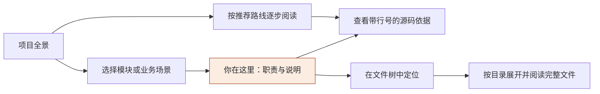

# AI 项目分析 · 交互项目地图

本次直接升级现有 Vue 应用的 AI 项目分析报告。项目地图置于报告顶部，延续杏光 Studio 的暖杏色、灰白底、实色控件和克制的排版。

## 需求与使用方式

面向第一次阅读项目的学生，以及需要快速理解提交内容的教师。采用 projectCodeTutor 的“先全局、再业务、再模块、最后源码”顺序：

| 入口 | 解决的问题 | 交互 |
| --- | --- | --- |
| 全局地图 | 项目有哪些模块，各自负责什么 | 选择节点，查看职责、技术栈与源码依据 |
| 业务场景 | 一个业务场景在哪里实现 | 切换场景，查看说明和有共同文件引用的模块 |
| 阅读路线 | 第一次应该从哪里开始 | 按已有报告的顺序逐步阅读，支持上一步、下一步 |
| 文件树 | 文件在哪个目录，如何查看 | 整体默认收起；目录独立展开；路径搜索、全部收起、键盘导航 |

这里是重点：地图中的模块说明与源码引用来自当前报告。目录层级来自实际文件路径，不要求特定语言、模板或技术栈。文件树独立收起，不把全部目录铺满页面。

初次阅读可以先跳过分析过程、费用明细与高级设置，仍可从原来的分析详情入口查看。原有“项目概览、模块与链路、问题与证据、学习路线”四个页签完整保留。

## 关系依据与成本

- 全局图连线表示项目包含这些模块。
- 业务场景的关联按规范化后的完整引用路径计算，并明确标识为“共同引用文件”。相同文件名、文本相似、标题相似都不会生成关联；这些连线不表示调用方向或运行时依赖。
- 阅读路线保留报告原有顺序，不将其解释成程序执行顺序。
- 地图没有额外模型请求。历史报告可直接显示；完整源码/引用片段切换复用已经过鉴权返回的文件内容。
- 未形成模块、业务场景或阅读路线时显示明确的空状态，不编造节点。项目页面提供全部已导入文件；实训共享报告只展示其中被地图引用的文件，清楚标为“引用文件”。

## 影响范围

| 文件 | 职责 |
| --- | --- |
| `apps/web/src/lib/project-map.ts` | 纯数据派生、准确的文件引用关联、文件树层级 |
| `apps/web/src/components/SourceProjectMap.vue` | 地图、三种视角、选中说明、文件定位 |
| `apps/web/src/components/SourceFileTree.vue` | 独立目录展开、搜索、键盘操作、选择状态 |
| `apps/web/src/components/SourceProjectReport.vue` | 共享报告顶部集成 |
| `apps/web/src/views/Projects.vue` | 实际项目文件接入，源码片段与完整文件浏览 |
| `apps/web/src/components/ProjectSubmissionReview.vue` | 实训报告集成，继续使用原提交源码鉴权接口 |
| `tests/project-map.test.ts` | 完整路径关联、去重、空数据、排序与阅读顺序验证 |

## 交互与响应式约定

- 桌面：地图与解释并排；窄容器：地图在上，解释在下。窄屏选择节点后直达解释，可返回已选节点，避免来回寻找。
- 文件树方向键上下浏览，左右展开/收起，Home/End 定位首尾，Enter/空格打开文件。搜索会揭示匹配分支，清空后恢复此前展开状态。
- 点击“在文件树中定位”会展开祖先目录、聚焦并显示对应文件。所有入口继续使用原有源码读取权限、取消与超时机制。
- 地图模式、节点选择、目录折叠与搜索不会被相同内容的后台轮询刷新重置。切换不同报告则更新地图。
- 保留可见焦点、44px 操作区域和减少动态效果偏好；长文件路径不撑宽页面。

## 验收

交付页面为原项目地址，不另建原型入口：

`http://10.38.31.238:5174/projects/e66f1968-c9a3-4eac-a609-744864df2832`

- `pnpm -r typecheck` 通过；最终前端构建包含 `vue-tsc --noEmit`。
- `pnpm --filter @codelab/web build` 通过。整个应用仍有主包超过 500 kB 的构建提示；本次没有调整全局拆包策略。
- `vitest run tests/project-map.test.ts`：9/9 通过。
- 文件树组件的内存挂载检查：搜索后手动折叠，替换全部文件对象并倒序、更新行数，折叠状态保持；清空搜索恢复原展开状态。
- 真实页面检查：1440×1000 桌面、390×844 手机；长中文标题和路径正常，页面与文件树均无横向溢出。
- 当前报告显示 8 个模块、5 个场景和 6 步阅读路线；切换历史成功报告显示 9 个模块，切回最新报告恢复 8 个模块。
- 模块说明、业务场景选择、阅读路线前后切换、相关场景跳转焦点、原有分析页签、地图整体收起/展开均已检查。
- 从模块定位 `src/lib/forecast.ts`，自动展开文件夹并聚焦文件；文件树打开 175 行完整源码且无假引用高亮。引用入口保留 L119–160 的 42 行高亮，可在全文与引用片段间切换。
- 文件搜索的无结果状态、清空、独立折叠、全部收起、方向键展开，以及跨后台轮询后的状态保留均已检查。
- 实训共享报告完成组件与源码入口集成；本次真实浏览器交互验收使用上面的项目页面，没有新建实训提交或触发模型分析。

实装截图：

- [桌面项目地图](evidence/project-upgrade/project-map-desktop-20260930.png)
- [桌面文件定位](evidence/project-upgrade/project-map-desktop-tree-20260930.png)
- [手机文件树](evidence/project-upgrade/project-map-mobile-tree-20260930.png)

## 可选的理解练习

可以选择一个模块、一个业务场景，或从阅读路线第一步开始。小问题：图中的“共同引用文件”能否直接证明两个模块会互相调用？不能；需要继续核对源码中的调用与数据传递。
